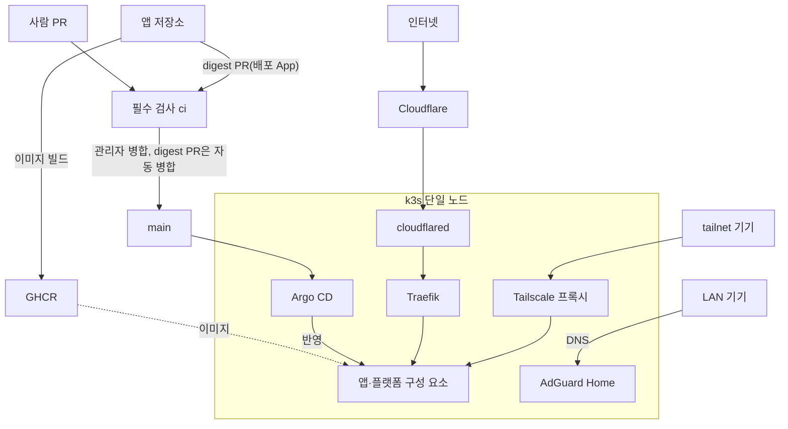

# homelab

단일 노드 k3s 홈랩 저장소다. main에 병합된 내용을 Argo CD가 클러스터에 반영하므로, 클러스터는 손으로 고치지 않고 PR로 바꾼다. 병합하려면 필수 검사 `ci`를 통과해야 한다.

## 구성

- **클러스터:** k3s 단일 노드, nftables(파드 egress 규칙)
- **GitOps:** Argo CD, Helm, Kustomize
- **네트워크:** Traefik, Cloudflare Tunnel, Tailscale operator, cert-manager, AdGuard Home
- **데이터:** CloudNativePG(PostgreSQL), Valkey, Cloudflare R2(백업)
- **시크릿:** Infisical, External Secrets Operator
- **관측:** VictoriaMetrics, VictoriaLogs, Grafana, Alertmanager, Vector
- **CI·배포:** GitHub Actions, GHCR, GitHub App(배포·병합), Renovate
- **IaC:** Terraform(GitHub, Cloudflare, Tailscale)
- **운영 도구:** `homelab` CLI(Bun·TypeScript), mise

## 동작 방식



- **배포:** 앱 저장소가 이미지를 GHCR에 올리면 배포 App이 `apps/<앱>/image.yaml`의 digest를 바꾸는 PR을 연다. 관리자 검토 없이 병합되는 PR은 이것뿐이다([자동 병합 조건](.github/workflows/README.md)).
- **접근:** 외부 요청은 Cloudflare 터널로 들어온다. 관리 화면은 tailnet에서만 열리고, `go/argocd`처럼 짧은 주소로 연다. `go`가 안 되면 `https://<이름>.<tailnet>.ts.net`으로 직접 연다.

## 디렉터리

- `host/`: 호스트 설정. 사람이 `sudo host/install.sh`로 적용한다.
- `platform/`, `apps/<앱>/`, `data/<앱>/`: 플랫폼 구성 요소, 앱 배포, 앱 데이터. Argo CD가 적용한다.
- `infra/`: Terraform. 관리자가 로컬에서 apply한다.
- `cli/`: 앱 추가, 복구, 자격 회전에 쓰는 `homelab` CLI.
- `tools/`: `ci` 검사 코드.

## 문서

- [문서 지도](docs/plans/2026-10-17-homelab-rebuild/README.md): 계획·설계 문서를 어떤 순서로 읽을지
- [운영 절차](docs/runbooks-public/)
- [에이전트 작업 규칙](AGENTS.md)

## 로컬 개발

```sh
mise install                # 도구 설치(.tool-versions)
pre-commit run --all-files  # 커밋 전 검사
bun run ci                  # CI 필수 검사와 같은 검사
```
