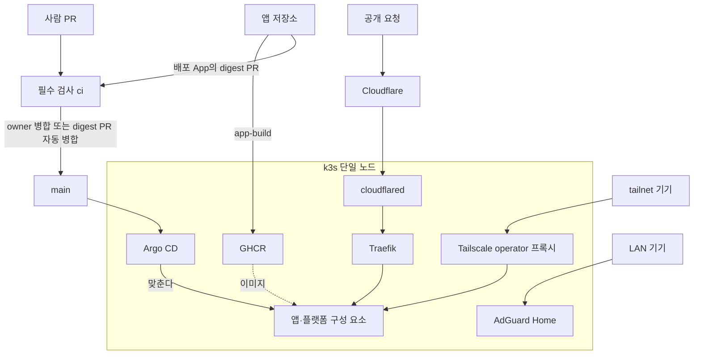

# homelab

NUC 한 대에서 도는 k3s 홈랩의 원본 저장소다. Git이 원본이고, Argo CD가 main을 클러스터에 맞춘다.
클러스터는 손으로 바꾸지 않는다. main은 PR과 필수 검사 `ci`를 거쳐서만 바뀐다.

## 사용 기술

- **클러스터:** k3s(단일 노드), nftables(파드 egress 규칙).
- **GitOps:** Argo CD(root Application, ApplicationSet), Helm, Kustomize.
- **네트워크·접근:** Traefik, Cloudflare Tunnel(cloudflared), Tailscale operator, cert-manager, AdGuard Home.
- **데이터:** CloudNativePG(PostgreSQL), Barman Cloud Plugin, Valkey, Cloudflare R2(백업).
- **시크릿:** Infisical, External Secrets Operator.
- **관측:** VictoriaMetrics, vmalert, vmauth, Alertmanager, Grafana, VictoriaLogs, Vector, kube-state-metrics, node-exporter.
- **CI·배포:** GitHub Actions, GHCR, 배포·병합 GitHub App, Renovate, pre-commit, gitleaks, actionlint, shellcheck, kubeconform.
- **IaC:** Terraform(GitHub, Cloudflare, Tailscale).
- **운영 도구:** Bun·TypeScript(`homelab` CLI, 검사 코드), mise.

버전은 여기 적지 않는다. 도구는 `.tool-versions`, k3s는 `host/versions.env`, 외부 차트는 `platform/root/templates/`, 이미지는 각 매니페스트의 digest가 원본이다.

## 아키텍처



- **변경:** PR은 `ci`를 통과하고 owner 검토를 거쳐 main에 들어간다. Argo CD가 main을 폴링해 클러스터에 적용한다.
- **앱 배포:** 앱 저장소가 `app-build`로 이미지를 GHCR에 올리면 배포 App이 `apps/<앱>/image.yaml`의 digest PR을 연다. 조건을 모두 맞춘 이 PR만 사람 승인 없이 병합된다([조건](.github/workflows/README.md)).
- **접근:** 공개 경로는 Cloudflare → 터널 → Traefik이다. 내부 UI는 tailnet 안에서만 열린다. tailnet 기기의 브라우저에서 `go/<이름>`(예: `go/argocd`)을 치면 `https://<이름>.<tailnet>.ts.net`으로 넘어가고, `go`가 멈춰도 전체 주소는 그대로 열린다.

### 저장소 배치

- `host/`: 호스트 설정. 사람이 `sudo host/install.sh`로 적용한다.
- `platform/`: 플랫폼 구성 요소. Argo CD가 main에서 적용한다.
- `apps/<앱>/`: 앱 배포 선언. `image.yaml`은 배포 App이 쓴다.
- `data/<앱>/`: 앱 데이터 선언.
- `infra/`: Terraform root. owner가 로컬에서 apply한다.
- `cli/`: 앱 추가·복구·회전 같은 운영 절차를 담은 `homelab` CLI.
- `tools/`: `ci` 검사 코드와 셸 시험.

## 문서

- 문서 지도: [docs/plans/2026-10-17-homelab-rebuild/README.md](docs/plans/2026-10-17-homelab-rebuild/README.md). 무엇이 어디 있고 어떤 순서로 읽는지.
- 계획 명세: [docs/plans/2026-10-17-homelab-rebuild/spec.md](docs/plans/2026-10-17-homelab-rebuild/spec.md). 결정, 인수 조건, 티켓 목록.
- 플랫폼 설계: [docs/plans/2026-10-17-homelab-rebuild/platform/design.md](docs/plans/2026-10-17-homelab-rebuild/platform/design.md). 저장소 배치는 C.1, 누가 무엇을 바꾸는지는 C.2, 내부 UI 경로는 C.3.5.
- 운영 절차: [docs/runbooks-public/](docs/runbooks-public/).
- 에이전트 작업 규칙: [AGENTS.md](AGENTS.md).

## 로컬 개발

```sh
mise install               # .tool-versions의 도구를 맞춘다
pre-commit run --all-files # 커밋 전 검사(매 커밋마다 돌리려면 pre-commit install)
bun run ci                 # 필수 검사 ci와 같은 검사(tools/ci/)
```

CI가 보는 것은 `.github/workflows/ci.yaml`에 있다.
