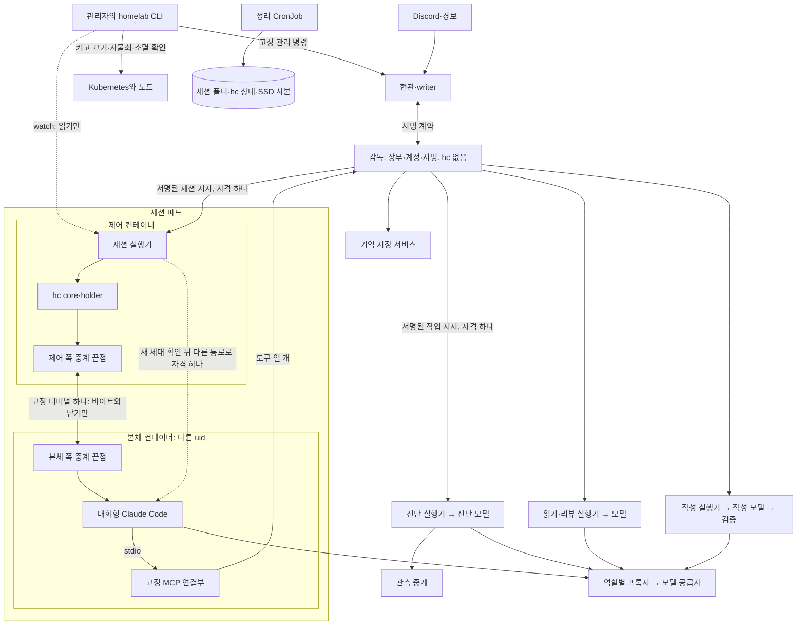

# 올리브의 감독, 실행기, hc

감독(O09), 오케스트레이터(O10), 세션 파드 안 hc 검증(O02), 본체 컨테이너 분리 검증(O25)의 구현 기준이다. 이 문서는 조사 초안(저장소 밖)을 줄인 것이고, 관리자 결정은 `spec.md` §5.1이 기준이다. 초안과 §5.1이 다르면 §5.1이 이긴다. Discord 글의 모양은 `discord.md`, 진단 과정은 `diagnosis.md`를 따른다.

- 상태: 구현 전. D-37(작업자와 hc의 자리), D-38(켜고 끄는 값과 정지 자물쇠), D-39(정지 완료의 증거), D-47(본체를 다른 uid·다른 컨테이너로 분리)은 관리자 결정이다. D-47은 O25의 실측(1차 2026-11-16, 2차 2026-11-17) 뒤 관리자가 2026-11-17에 확정했다(§2.4). §11의 항목은 기본값(관리자 미확정)이되, S-04와 S-05는 관리자가 2026-11-18에 정했고(D-56, D-58), S-09는 거는 방법만 정해졌다(D-57). 결정에서 따라 나온 구현 설계는 [추론]으로 구분한다.
- 표시: [확인] 저장소의 선언·코드, 공식 문서, hc 0.1.17과 Argo CD 3.5.5의 소스를 읽은 것. 조사 초안의 대조와 반박 검토가 확인했다고 적은 것만 붙였다. [추론] 그 근거에서 낸 설계. [미확인] 실제로 돌려 봐야 아는 것. 소스를 읽은 것은 돌려 본 것이 아니다.
- 근거: `homelab`의 `5f85a642b09364606b6990aa73af9927df23dbbd`. 저장소 경로는 이 revision 기준이다.
- 파드·네임스페이스 이름, 경로, 숫자, 명령 이름은 모두 초안이다. O09·O10이 정한다.

## 1. 한눈에 보기

- **감독**은 모델이 아닌 프로세스다. 장부, 계정 묶음, 지시 서명 키를 쥔다. hc도 Kubernetes 쓰기 권한도 없다.
- **실행기**는 파드마다 하나 있는 고정 프로그램이다. 감독이 서명한 지시만 받아 모델 프로세스를 띄우고 끝낸다. 명령·이미지·경로를 밖에서 받지 않는다.
- **hc는 오케스트레이터 세션 파드에만 있다**(D-37). 그 파드의 실행기가 감독의 지시로만 쥔다.
- **본체는 hc와 다른 컨테이너에서 돈다**(D-47). 세션 파드 안에서 hc core·holder·세션 실행기는 제어 컨테이너에, 본체(대화형 Claude Code, MCP 연결부, 훅)는 다른 uid의 본체 컨테이너에 있다. hc의 터미널 프로그램은 본체가 아니라 고정 터미널 하나를 잇는 중계다(§2.4).
- **작업자**(진단, 읽기·리뷰, 작성)는 역할별 파드에서 실행기가 직접 띄운다. hc 터미널이 아니다. `spec.md` D-01의 "하위 에이전트"가 이것이다.
- **켜고 끄기와 비상 정지**는 관리자의 `homelab` CLI가 한다(D-21, D-38). 정지의 마지막 확인도 CLI가 한다(D-39).
- **보기**는 `homelab olive watch`다. 본체 화면과 작업자가 하는 일을 보기만 한다. 작업자에 끼어들 수 없고 취소만 된다.

### 1.1 파드와 네임스페이스 [추론, 이름은 초안]

| 네임스페이스 | 도는 것 | 쥐는 것 | 없는 것 | 비상 정지 때 |
|---|---|---|---|---|
| `app-homelab-bot` | 현관·writer | Discord·GitHub 쓰기 자격, 현관 DB | 모델 계정, hc, 감독 장부 | 떠 있음(접수만 닫힘) |
| `olive-control` | 감독 | 감독 장부, 계정 묶음, 지시 서명 키 | hc, 모델 프로세스, 클러스터 토큰, Kubernetes 쓰기 | 0개 |
| `olive-session` | 제어 컨테이너: 세션 실행기 → hc core·holder → 중계. 본체 컨테이너(다른 uid, D-47): 대화형 Claude Code, 고정 MCP 연결부, 관리 훅 | 이번 세션의 자격 하나(본체에게만), 세션 폴더(hc 상태는 제어 쪽), 세션 실행기 자기 역할의 Ed25519 서명 키(실행기만. 본체와 hc에는 주지 않는다. 개인 키는 관리자가 만들어 제어 프로세스 전용 Secret으로 공급한다, D-73) | 다른 계정, 감독·현관의 서명 개인 키, 현관 DB | 0개 |
| `olive-diagnosis` | 진단 실행기 → 진단 모델·격리 셸 | 고정 snapshot, 자격 하나, 관측 중계 주소 | hc, 클러스터 토큰 | 0개 |
| `olive-reader` | 읽기·리뷰 실행기 → 도구 없는 모델. 이 자리의 일은 격리 읽기, PR 리뷰, 반박 검토이고, 실행기 하나에 역할 하나만 준다. 처음에는 격리 읽기만 등록한다(D-64, 아래) | 현관이 넘긴 자료, 자격 하나 | hc, fetch, 클러스터 | 0개 |
| `sandbox` | 작성 실행기(지금 `worker-task` 형태) → 작성 모델 → 검증 실행기 | 작업 PVC, 고정 snapshot | hc, 현관 자격, live cluster | 0개 |
| `olive-observation` | 관측 중계 | 진단 전용 읽기 SA | 모델, GitHub 쓰기 | 떠 있음 |
| `olive-memory` | 기억 저장 서비스(코드만) | 지도, 30일 메모, 승인 지식 snapshot | 서명 키, 모델 계정, hc | 떠 있음 |
| 원문을 둔 곳마다 | 정리 CronJob | 지울 권한만 | 모델, hc, 실행 시작권 | 돈다 |

- 구성 요소 다섯(`spec.md` §4)은 역할이고 파드 수와 다르다. `start_worker`는 미리 배포된 실행기에 새 모델 프로세스를 시작하게 할 뿐 파드를 만들지 않는다. 그래서 감독에게 Kubernetes 쓰기 토큰이 필요 없다.
- "0개"인 다섯(감독, 세션, 진단, 읽기·리뷰, 작성)이 이 문서의 **실행 Deployment**다. 모델 자격이 닿는 파드다.
- [결정, D-64] 배포 대상과 계약 역할: 배포 대상 ID `reader`, 네임스페이스 `olive-reader`, 그 안의 Deployment 이름 `executor`는 그대로 두고(`platform/olive/targets.yaml`), 대상 목록 한 곳에 그 대상이 맡을 수 있는 역할을 적는다. 실행기 한 개와 그 서명 키에는 역할 하나만 준다. 처음에는 격리 읽기(`isolated_reader`)만 등록하고, PR 리뷰(`pr_review`)는 별도 실행기를 승인하기 전까지 배정하지 않는다. 같은 자리의 실행기가 다른 역할을 주장하면 거절한다. 계약의 판을 올리지 않고 이미 병합한 차트·검사·정지 목록의 이름을 바꾸지 않는다. 정한 것은 허락의 단위까지다. 대상 목록에 허용 역할을 적는 칸의 모양, 그것을 대조하는 자리(차트, CI, 감독), 리뷰 실행기를 언제 승인할지는 정하지 않았다.
- [확인] 옛 작성 실행기는 시작할 때 PID 1과 자신 말고 프로세스가 있으면 거절하고, 끝낼 때 파드의 PID 공간 전체에 TERM·KILL을 보낸다. Unix 소켓을 모두 허용하는 설정도 있다(옛 봇 `src/task-containment.ts`, `src/executor-claude-task.ts`). 작성 파드에 hc를 넣지 않는 이유다.
- [결정, D-74] 실행기의 프로세스 공간에 실행기와 그 작업만 있다는 전제(§3의 5 "남은 프로세스 0개" 확인의 근거)는 배포가 전용 컨테이너를 보장하는 것으로 보증한다. 지금의 배치(컨테이너 하나, root 아님)를 쓰고, 그 컨테이너에 다른 것이 들어가지 못하게 배포와 운영 규칙으로 막는다(실행기 파드에 exec·디버그 컨테이너·exec 방식의 프로브를 두지 않는다). 파드가 교체될 때 옛 공간이 끝났는지는 밖에서 확인한다. 이 보증을 독립 환경에서 먼저 검증한다. 조건: 합류를 막을 수 없으면 실행기에 "전용 공간"이라고 넘기지 않고 실행과 슬롯 해제를 보류한다. 기준 상태가 깨끗하지 않을 때 복구 동작이 이전 공간을 정리할 수 있다고 가정하지 않는다. 감독 파드의 CLI 관리 exec(D-60, §9.1)는 이 결정과 다른 일이다. 정하지 않은 것: 합류를 막는 구체적인 수단(RBAC, 정책)과 그 검증 방법(차트 PR과 독립 환경 단계에서). D-100·D-102 뒤로 이 결정의 "그 컨테이너"는 작업자 실행기 파드의 역할 컨테이너를 가리킨다(전용 PID 공간이 역할 컨테이너로 옮겨 간다, 아래 줄). 위 "지금의 배치(컨테이너 하나, root 아님)"는 그 두 컨테이너로 바뀌었고, 나머지 규칙과 조건은 그대로다(`spec.md` §5.1 D-74).
- [결정, D-100·D-102·D-103] 작업자 실행기 파드는 실행기(제어) 컨테이너와 다른 uid의 역할 컨테이너로 나눈다(세션 파드 D-47과 같은 방향). 지금 모양(컨테이너 하나, uid 65532, 역할 프로그램을 같은 uid로 띄움)으로는 "모델과 도구는 개인 키와 서명 수단에 접근할 수 없다"(D-73)를 채우지 못하기 때문이다. 모델은 역할 컨테이너에서 돌고, 효과 서명 키와 TLS 개인 키는 제어 컨테이너에만 붙는다. 역할 컨테이너의 PID 1인 작은 대리가 역할 프로그램을 띄우고 지금의 정리 코어로 남은 프로세스를 센다. 제어는 공유 폴더(역할 컨테이너에 읽기 전용)의 유닉스 소켓 하나를 듣고 대리와 지시·결과만 주고받는다. PID 공간은 나누고 서명은 제어만 한다. 링크 이상은 모두 모름이다. "0"은 모델과 같은 uid의 대리가 센다(신호 보호·non-dumpable로 막지만 커널·대리 버그면 거짓 0이 가능하다, 관리자가 알고 정했다). 모델 쪽 이미지는 역할마다 따로 두고, 올리브 이미지(제어와 같은 digest)를 쓰는 init 컨테이너가 대리 실행 파일을 emptyDir에 놓아 역할 컨테이너가 읽기 전용으로 붙여 PID 1로 돌린다(올리브 이미지에는 모델 CLI를 넣지 않는다, D-54 그대로). 역할 컨테이너는 uid·gid 10002이고 파드의 `fsGroup: 65532`는 뺀다(남기면 역할 프로세스도 보조 그룹 65532를 얻는다). 정하지 않은 것: `fsGroup` 없이 uid 65532가 Secret 볼륨을 읽는 차트 모양(분할 PR에서), 역할 이미지의 출처(O10의 본체 이미지와 함께), 대리 실행 파일의 형태, 실행 폴더 정리의 자리, 링크 메시지의 꼴, 실행기 코드의 PidSpace의 새 꼴. 아직 구현되지 않았다: 지금 차트의 실행기 파드는 컨테이너 하나다.
- [확인] 작성 파드의 보안 예외는 CI가 `sandbox`의 그 파드에만 허용한다(`tools/ci/policy.ts`). 공용 앱 차트는 같은 네임스페이스 전체 연결, DNS, 일반 인터넷 443을 열고, `serviceAccountName`을 준 앱에는 SA 토큰을 자동 마운트한다(`platform/charts/app/templates/deployment.yaml`. 주지 않으면 마운트하지 않는다). [추론] 감독과 모델 파드는 전용 `platform/` 차트로 만든다. 프록시 허용 목록은 역할별로 나눈다.
- [확인] PID 상한은 파드 `resources.limits`가 아니라 kubelet 설정(`podPidsLimit`)이다.
- [결정, D-57] 자원 상한을 거는 방법: CPU·메모리는 파드별 한도와 실행 네임스페이스의 한도(ResourceQuota)로 강제한다. PID 상한은 지금 걸지 않는다. 노드의 kubelet 설정이라 다른 앱 파드에도 걸리기 때문이다. 시험 클러스터와 시범 운영의 실제 숫자를 본 뒤 별도 호스트 PR로 정하고, 그때까지 PID 항목(O09 할 일 4, §12)은 유예로 남아 완료로 세지 않는다. 숫자(`spec.md` B-07, §11 S-09)는 정하지 않았다.

## 2. hc의 자리와 쥐는 규칙

### 2.1 확인된 사실 [확인, hc 0.1.17 소스]

- client별 인증·권한이 없다. core 소켓에 닿으면 그 계정으로 명령 실행, 파일 읽기·쓰기, 터미널 입력·종료를 모두 할 수 있다. holder 소켓도 같다(argv·env·cwd를 받아 프로그램을 띄운다).
- `hc run`은 부른 쪽이 아니라 **core의 환경**을 프로그램에 넘긴다. CLI가 따로 넘기는 것은 TERM 계열 변수 넷뿐이다.
- API로 넘긴 env override는 `terminals.json`에 남는다. argv도 기록된다.
- core는 프로그램 환경에 터미널 소켓 경로(`HC_TERMINAL_SOCKET`) 등을 넣는다. "경로를 모를 것"은 방어가 아니다.
- holder가 core를 다시 띄울 수 있다. `hc kill`은 종료 기록과 마지막 화면을 남기고, `hc rm`은 삭제 오류를 무시한다.
- 종료 뒤 기본 보관은 24시간·500개다. 받은 시각 기준이 아니다.
- `hc attach --observe`는 키 입력과 크기 변경을 보내지 않는다. 그러나 화면의 제어 문자를 거르지 않고, core가 없으면 새로 띄운다. observe는 권한 등급이 아니다.
- machine 연결에는 원격에서 로컬 부모 터미널로 `send`가 가는 길이 있다.

### 2.2 규칙(D-37)

1. **자리:** hc는 세션 파드에만 있다. 감독 파드와 작업자 파드에는 hc 실행 파일도 소켓도 없다.
2. **쥐는 자:** 세션 실행기만 hc를 쥔다. 감독의 서명된 지시(§9.2)가 있을 때만 core를 띄우고 프로그램을 연다.
3. **세션마다 새 core:** 하루 교체(§6)와 계정 세대가 바뀔 때마다 core를 새로 띄우고, 그 core의 환경에 이번 자격 하나만 준다. 같은 core를 두고 자격만 바꾸지 않는다. [확인, O02 실측] 새 core의 프로그램은 이번 표식만 받았고 앞 세션의 표식은 상태 파일에 남지 않았다. 기존 core는 client가 다른 값을 들고 불러도 core의 값을 주지만, core 소켓에 닿는 쪽이 `server restart --fresh`를 부르면 그 client의 환경으로 바뀐다. **D-47로 바뀌는 것:** 세션마다 새 core는 그대로지만, 구독 자격은 core 환경에 넣지 않는다. hc의 터미널 프로그램은 중계라 자격을 물려받을 이유가 없다. 실행기는 새 세대가 확인된 뒤 중계와 다른 통로로 이번 자격 하나를 본체에게만 준다(§2.4). 이 규칙의 첫 문장("그 core의 환경에 이번 자격 하나만 준다")을 바꾸는 명시적 변경이다. 통로의 모양은 O25가 시험했고 O10이 정한다.
4. **자격을 argv와 env override로 넘기지 않는다.** hc 상태 파일에 남는다. 실행기 자신의 연결 키와 영수증 키는 core 환경에 넣지 않는다. [확인, O02 실측] env override와 argv 모두 `terminals.json`에 `hc rm` 전까지 남았다. core 환경의 값은 어느 파일에도 적히지 않았다.
5. **정지의 증거로 쓰지 않는다:** `hc kill`, core 종료, hc의 종료 기록은 프로세스가 사라졌다는 증거가 아니다. 증거는 §7.4다. [확인, O02 실측] `hc kill`이 터미널을 끝났다고 기록한 뒤에도 `setsid`·`nohup`·데몬 방식·TERM 무시 후손이 남았고, `--outlive-parent` 자식도 남았다. 모두 파드 cgroup 안이었고 파드 종료 뒤 사라졌다. D-47 뒤에는 hc의 자식이 중계라 `hc kill`은 중계만 끝내고 다른 PID 공간의 본체는 그대로 둔다. 중계의 끝남, 중계 소켓이 다시 생김, 본체의 "끝났다"·`exit 0`·새 세션 ID 응답도 본체가 사라졌다는 증거가 아니다 [추론, Podman 실측에서 본체가 중계 소켓을 바꿔치기했다]. 일상 세션 교체의 증거는 §2.4와 §6이다.
6. **hc 상태는 원문이다:** hc의 상태·화면·로그 경로를 세션 폴더 안에 둔다. 받은 때부터 168시간이고 세션 폴더와 함께 지운다. 종료 뒤 기본 보관에 기대지 않는다. [확인, O02 실측] 남는 자리의 목록은 O02 결과("O18에 넘긴 것")에 있다.
7. **소켓 둘 다 가린다:** client 소켓과 holder 소켓을 본체(모델, MCP 연결부, 훅)에서 모두 가린다. 방법은 D-47이다: 같은 세션 파드 안에서 본체를 hc와 다른 uid·다른 컨테이너로 분리해 운영체제 경계로 가린다. 오케스트레이터의 도구 정책(§4의 도구 열 개, §5의 관리 설정)과 자격 최소화는 보조 통제이고, 가림을 도구 정책에만 맡기지 않는다. 구조와 O25의 실측 결과는 §2.4다. [확인, O02 실측] 같은 컨테이너·같은 uid의 모델·도구 역할은 두 소켓, 상태·설정, `/proc`의 다른 프로세스 환경에 모두 닿았다. 다른 uid 컨테이너와 다른 파드는 못 닿았다. 이 파드 설정에서는 권한 없는 user 네임스페이스를 만들 수 없다. [추론] 모델을 holder의 자식으로 띄우면 같은 컨테이너·uid에서 뜨므로 운영체제로 가릴 수 없다. 그래서 D-47은 hc의 터미널 프로그램을 중계로 바꾸고 본체를 본체 컨테이너에서 띄운다. [확인, Podman 실측 2026-11-16] Landlock은 이 커널(ABI 8)에서 경로 Unix 소켓 연결을 막지 못해 탈락했다.
8. **machine 등록 금지:** 관리자 개인 hc에 올리브 파드를 machine으로 등록하지 않는다. 올리브의 core를 다른 core에 잇지도 않는다. 본체 컨테이너에 두 번째 hc를 두고 machine으로 잇는 것도 중계의 대신으로 쓰지 않는다 [추론: hc machine은 원격에서 부모 터미널로 입력을 보내는 역방향 호출이 있는 상호 신뢰 프로토콜이다].
9. **상태 표시는 보조다:** hc의 idle·done과 화면의 "완료", "승인됨"은 성공·승인의 증거가 아니다. 감독은 자기가 낸 실행 ID, 관리 훅 이벤트, 결과 저장 영수증을 대조한다.

### 2.3 보기: `homelab olive watch` [추론]

- 본체 화면은 세션 실행기의 고정 읽기 전용 내보내기에서 받는다. 작업자가 하는 일은 감독 장부의 실행 목록, 단계, 정제된 출력으로 본다. 작업자 화면은 hc에 없다.
- 관리자 쪽 CLI 코드가 제어 문자를 걸러 그린다. 원시 화면 바이트를 관리자 단말에 그대로 쓰지 않는다.
- 입력을 보내지 않는다. 키, 붙여넣기, 크기 변경, 단말 질의 응답이 세션에 가지 않는다.
- 있는 core만 본다. core가 없거나 정지 중이면 "볼 것 없음"으로 끝난다. `hc attach --observe`를 그대로 감싸지 않는다.
- [확인, O02 실측, hc 0.1.21] core가 없을 때 `hc server status`·`ls`·`read`·`events`·`attach --observe`는 모두 core를 띄웠고, 소켓에 직접 연결해 보는 확인만 띄우지 않았다. `hc read`·`read --json`의 출력에는 제어 문자가 없고 `attach --observe`에는 있다. `read`와 `attach --observe`는 프로그램에 입력을 보내지 않았다.

### 2.4 본체 컨테이너 분리(D-47)

본체 전체(모델, MCP 연결부, 훅)를 운영체제 경계 안에 두는 것이 D-47의 원칙이다. 이 절은 지금 정해진 것, O25가 실측한 것, 뒤 티켓이 정할 것을 나눠 적는다. O25의 1차(2026-11-16)·2차(2026-11-17) 시험 뒤 관리자가 2026-11-17에 D-47을 확정했다. 남는 한계는 O25 "D-47 확정"에 있고 O09·O10이 이어받는다.

**지금 정해진 것(D-47)**

- 같은 세션 파드 안에 컨테이너 둘을 둔다. 제어 컨테이너에는 hc core·holder·세션 실행기가, 본체 컨테이너에는 대화형 Claude Code·MCP 연결부·관리 훅이 있다. 두 컨테이너는 uid가 다르다.
- 둘은 고정 터미널 하나를 잇는 좁은 중계로만 이어진다. hc의 터미널 프로그램은 본체가 아니라 제어 쪽 중계 끝점이다. 중계 소켓은 제어 쪽이 자기 폴더에 만들어 듣고, 본체 쪽 끝점이 거기에 붙는다(본체에는 그 폴더가 읽기 전용이라 소켓을 만들거나 바꿀 수 없다). 본체 컨테이너에는 hc 실행 파일·소켓·상태를 두지 않는다.
- 도구 정책(§4, §5)과 자격 최소화는 보조 통제다. 어느 경우에도 가림을 "도구 정책만"으로 돌리지 않는다.
- hc 위의 대화형 본체(D-01, D-37)가 전제다. 본체를 Agent SDK·헤드리스 스트리밍으로 바꿔 hc와 터미널을 없애는 방식은 쓰지 않는다.

**D-47 확정 뒤 정해진 것(D-50~D-52, 관리자 2026-11-17)**

- **교체의 영수증(D-50):** "옛 본체가 끝났다"의 관문은 kubelet의 전체 컨테이너 재시작 순서와 init이 만드는 새 세대 표식(한 번 쓰는 시작 허가)이다. 세션 실행기가 남은 프로세스 0개를 직접 확인하지 않는다(§6 3, §9.2). k3s·containerd를 올릴 때마다 노드 관측으로 순서를 다시 확인하고, 자격 발급 길에는 특권 구성 요소를 더하지 않는다. 점검을 어디서 누가 언제 돌릴지는 `spec.md` §5.3의 미정이다.
- **새 파드의 규칙 확인(D-51):** 새 세션 파드는 뜰 때마다 첫 자격 전에 일부러 전체 재시작을 한 번 시켜 재시작 규칙이 실제로 붙어 있는지 확인한다. 규칙이 빠진 파드는 자격 0회로 시작을 거부한다. 비용은 기동마다 약 4초와 재시작 횟수 하나다.
- **세션이 깨졌을 때(D-52):** 본체가 죽거나, 본체 컨테이너만 다시 뜨거나, 중계가 끊기면 세션 실행기가 감독에 알리고, 감독이 하루 교체와 같은 절차(§6, 인계 묶음 포함)로 전체 재시작을 지시한다. 감독이 없으면 멈추고 경보를 낸다. 반복 재시작의 상한은 기동 실패 한도이고, 한도와 멈춘 모양(`hold`)은 `spec.md` §5.3의 미정이다.

**구조가 바뀌는 것 [추론, 설계 검토와 반박 검토의 제안. O25가 시험 차트로 실측했고(아래), 운영 세부는 O09·O10이 정한다]**

- **중계의 범위:** 중계는 바이트와 닫기만 나른다. 명령·인자·환경·파일을 받지 않고, hc API를 넘기지 않으며, 끊긴 뒤 스스로 새 본체를 만들지 않는다. 본체 명령은 본체 컨테이너의 이미지·명령줄에 고정한다. 중계에서 오는 바이트는 늘 믿지 않는 입력으로 다룬다(본체가 중계 끝점을 통째로 쥔다). 중계의 "끝남"은 화면 상태일 뿐 본체가 사라졌다는 영수증이 아니다.
- **화면은 고정 크기다.** 중계가 크기 변경을 나르지 않는다. [확인, Podman 실측 2026-11-16] 제어 쪽 pty 크기를 바꿔도 본체 쪽은 그대로였고, 고정 크기에서 Claude Code 첫 화면은 정상으로 그려졌다. hc 화면 크기와 본체 쪽 고정 크기가 어긋나는 것은 O10이 맞춘다.
- **중계 폴더:** 제어 쪽이 소유하고 제어 쪽만 쓴다. 본체에는 읽기 전용으로 붙인다(Unix 소켓 연결은 읽기 전용 볼륨에서도 된다). [확인, Podman 실측 2026-11-16] 본체가 쓸 수 있는 공유 폴더에서는 본체가 중계 소켓을 지우고 자기 리스너를 심어 제어 쪽의 다음 연결을 가로챘다. hc 폴더·자격·상태·HOME은 이 볼륨에 넣지 않는다. 파드 공통 `fsGroup`이 hc 폴더까지 그룹 쓰기를 주지 않게 한다.
- **자격 전달:** 구독 자격은 새 세대가 확인된 뒤 중계와 다른 통로로 본체에게만 준다. argv·hc env override·로그·일반 공유 파일에 쓰지 않는다. §2.2 규칙 3의 명시적 변경이다. 여러 계정의 Secret이나 공용 "선택 자격" Secret을 본체 컨테이너에 붙이지 않는다(옛 본체가 갱신된 자격을 읽을 수 있다). 침해된 본체가 자기 세션의 구독 토큰을 훔치는 것은 이 구조로도 막지 못한다. 세션을 끝내도 훔친 토큰이 무효가 되지 않는다.
- **세션 교체:** 본체 컨테이너를 세션마다 새로 띄운다. [확인, Podman 실측 2026-11-16] 본체 컨테이너를 이어 쓰면 앞 세션의 남은 프로세스가 다음 세션 본체의 가짜 자격을 `/proc`에서 읽었다. "본체가 정말 새로 떴다"를 본체의 말로는 알 수 없으므로, 교체를 Kubernetes의 전체 컨테이너 재시작(`restartPolicyRules`의 `RestartAllContainers`)에 묶는 안이다: 실행기가 정한 종료 코드로 끝나면 kubelet이 모든 컨테이너를 끝내고 일반 init 컨테이너부터 다시 띄운다. init이 제어 쪽에만 붙인 폴더에 새 세대 표식과 한 번 쓰는 시작 허가를 만들고, 새 실행기는 그것을 한 번만 쓴 뒤에만 본체에 자격을 준다. 실행기에게 Kubernetes API 자격은 주지 않는다. 이 순서를 교체의 관문으로 쓰는 것은 D-50이 정했다. 순서는 §6.
- **재시작 뒤에도 emptyDir은 남는다.** [확인, O25 1차 실측] 전체 재시작 뒤 본체 폴더에 앞 세대들의 파일이 남았다. 그래서 세대마다 새 경로(새 UUID의 HOME·설정·tmp·중계·hc 상태)를 쓰고, 본체가 쓰던 파일을 다음 세대의 신뢰하는 시작 코드가 읽거나 실행하지 않는다. 시작 허가를 둔 폴더는 본체에 붙이지 않는다.
- **PID 공간은 나눈다**(`shareProcessNamespace: false`, 기본값). 본체 컨테이너의 PID 1이 끝나야 커널이 그 공간의 나머지를 끝낸다는 보장이 선다. 옛 작성 파드의 `shareProcessNamespace: true`를 복사하지 않는다.
- **같은 파드의 네트워크는 공유된다.** [확인, Podman 실측 2026-11-16] 본체 자리에서 abstract 소켓과 localhost TCP에 닿았고 `/proc/net/unix`에서 hc 소켓 이름이 보였다(연결은 안 됨). 제어 쪽이 파드 네트워크에 여는 수신점은 본체가 직접 붙는다고 보고 인증·거절한다. 방법은 `spec.md` §5.3의 미정이다(아래 `/dev/shm`도 같은 줄에 든다). 감독과의 연결은 그 미정에서 빠졌다(D-55, 관리자 2026-11-17): 세션 실행기가 감독에 먼저 붙어 연결을 유지하므로 제어 컨테이너에 감독용 수신점을 두지 않는다. 미정에 남은 것은 건강 확인·지표 포트와 `/dev/shm`이다.
- **메모리:** 본체 컨테이너에 따로 상한을 둔다. [추론] O02의 `memory.oom.group=1`은 같은 컨테이너 안의 일이었으므로 본체의 메모리 초과에서 제어 쪽이 살아남을 여지가 생긴다. O25는 1차·2차 모두 이것을 재지 않았다(2차의 본체만 재시작은 TERM으로 했고 메모리 초과 시험이 아니다).
- **`/dev/shm`은 파드 안에서 공유된다.** [확인, O25 2차 실측 2026-11-17] 두 컨테이너가 같은 `/dev/shm`(64MiB, `drwxrwxrwt`)을 보고 두 uid 모두 그곳에 파일을 만들 수 있었다. 제어가 만든 파일(0600)은 본체에 보였고, 본체가 만든 파일(0644)은 제어에 보이고 내용이 맞았다.

**설계 제약: `kubectl exec`로 들어간 프로세스는 컨테이너의 원래 프로세스와 다른 AppArmor 라벨을 받는다**

- [확인, O25 1차 실측 2026-11-16, 승인된 `step summary` 단계를 돌리는 동안 노드에서 읽음] 이 노드에서 컨테이너의 원래 프로세스는 `cri-containerd.apparmor.d (enforce)`, `kubectl exec`로 들어간 셸과 그 자식(`timeout`, `sleep`, 그 셸이 띄운 `python3`)은 `cri-containerd.apparmor.d//&unconfined (enforce)`였다. uid·gid·capability·`NoNewPrivs`·seccomp·`/proc/<pid>/environ`의 소유자와 모드는 같았다.
- [확인, O25 1차 실측] 프로세스 환경 읽기는 방향에 따라 달랐다. 막힌 것은 **exec로 들어온 프로세스를 대상으로 하는 읽기**다.

  | 읽는 쪽 → 읽히는 쪽 | 결과 | 근거(O25 "결과") |
  |---|---|---|
  | 원래 프로세스 → exec로 들어온 프로세스 | EACCES | 7단계: 제어 쪽 PID 1 계통의 검사기가 요청을 넣은 셸·`timeout`·`sleep`의 환경을 못 읽음(3개) |
  | exec로 들어온 프로세스 → exec로 들어온 프로세스 | EACCES | 8단계: exec로 들어온 본체 쪽 검사기가 같은 exec 계통의 `bash` 둘을 못 읽음 |
  | exec로 들어온 프로세스 → 원래 프로세스 | 읽힘 | 8단계: 같은 검사기가 본체 PID 1과 본체 프로그램(pid 7)의 환경을 읽었다 |

- [확인, O25 2차 실측 2026-11-17] 원래 계통 → exec로 들어온 프로세스 방향의 신호 0은 요청마다 모두 OK였다(셸 변형 다섯 요청과 Claude 변형 세 요청의 `sig0=OK`). 라벨 두 줄은 1차와 같았다.
- [확인, O25 2차 실측] 자격 흔적 검사는 요청 제출과 결과 회수를 나눠, `kubectl exec`로 들어온 제출자가 사라진 것을 원래 PID 1 계통이 확인한 뒤(`gate state=gone`) 그 계통에서 검사하고 결과를 컨테이너 로그로 회수하는 방식으로 `됨`이 됐다. 검사 대상에 exec 계통이 남지 않아 매번 `unreadable=0`이었고, AppArmor 정책은 바꾸지 않았다.
- [미확인] exec 쪽에서 제어 쪽 원래 프로세스(hc core·holder, 실행기)를 읽을 수 있는지는 재지 않았다(본체 쪽 표본에서만 봤다). 신호는 exec 쪽 → 원래 PID 1로 신호 0이 통했다는 것만 간접으로 보였다(단계가 돌았다). 2026-11-06의 커널 7.0.0-42 사고(컨테이너 신호가 AppArmor로 막힘)도 원래 라벨이 겹친 라벨을 상대로 한 거부였다 [추론, 같은 계열일 수 있음].
- 그래서 운영 설계에서 `kubectl exec`로 띄운 프로세스를 검사 대상으로 남기지 않는다. 세션 프로세스를 검사하거나 끝내는 일은 컨테이너의 원래 PID 1 계통(실행기와 그 자식)이 한다. exec로 들어가 원래 프로세스를 읽는 것은 본체 쪽 표본에서 됐지만, 운영 절차나 관리자 CLI가 exec로 들어가 세션 프로세스를 읽거나 끝내는 방식은 그 방향과 대상을 먼저 재지 않고 설계하지 않는다.

**O25가 실측한 것(1차·2차)** (판정 문장은 `issues/O25-verify-split-main-container.md`의 완료 조건. 1차 시험 2026-11-16, 2차 시험 2026-11-17, 근거는 그 티켓의 "결과"와 "2차 시험 결과")

- 이 클러스터(`v1.36.6+k3s1`, containerd `2.3.7-k3s1.36`, 기능 `ContainerRestartRules`·`RestartAllContainersOnContainerExits` 켜짐 [확인, 2026-11-16])에서 전체 재시작이 "옛 것을 다 죽인 뒤 새로 띄움" 순서로 도는지. **1차 결과: 됨(1회).** 노드에서 옛 본체 소멸 → `fetch-hc` → `gen` → 제어 → 본체 순서였고, 소멸 확인이 첫 init 시작보다 61ms 이상, 새 자격 제공보다 3332ms 이상 앞이었다. 파드 UID는 그대로다. 조건 이름은 `AllContainersRestarting`이고, 재시작된 컨테이너의 `last.exit`는 137이다. **2차 결과(셸 변형): 됨.** 두 번째 전체 재시작 회차에서도 노드 네 줄이 `됨`이고, 소멸 확인이 첫 init 시작보다 50ms 이상, 새 자격 제공보다 3371ms 이상 앞이었다(첫 init 여유는 1차보다 좁지만 커널 시작 tick 10ms의 다섯 배 넘게 넓다). 노드 판정은 셸 본체로만 쟀다.
- 거짓 종료, 중계만 끊기, 실행기만 죽이기에서도 옛 본체가 살아 있는 동안 새 자격이 한 번도 나가지 않는지. **1차 결과: 됨.** 세 경우와 전체 재시작, 규칙 누락에서 새 자격 0회. 실행기만 죽이기(ctl-crash)의 init 순서 줄은 단독으로 다시 뜬 제어 컨테이너 때문에 예상대로 `판단 필요`다. **2차 결과(셸 변형): 됨, "본체 컨테이너만 재시작" 포함.** 본체만 재시작하면 본체만 컨테이너 ID가 바뀌고 제어·init의 ID와 재시작 횟수, 파드 UID는 그대로였다. 다시 뜬 본체는 자격 없이 기다렸고(41초 동안 그 세대의 자격 제공·전달 0회, 중계는 끝남), 되살리는 길은 전체 재시작이었다(다음 전체 재시작이 새 세대를 띄우고 자격을 1회 줬다). 이 회차에서 `AllContainersRestarting`은 바뀌지 않았다.
- 본체 쪽에서 정확한 경로로 hc 소켓에 직접 붙어도 거부되는지. **1차 결과: 됨.** 정확한 경로 3곳 모두 ENOENT, 중계 폴더 쓰기는 EROFS. **2차 결과: 됨**(셸 변형과 Claude 변형 모두. Claude가 살아 있을 때 파드 netns의 수신점 0개).
- 중계를 거쳐 실제 Claude Code가 대화형으로 도는지(Podman에서는 자격 없이 첫 화면까지 됨). **2차 결과(Claude 변형, 2.1.325): `4.claude.대화형 됨`.** 첫 화면·입력·Ctrl-C·고정 50×200·화면 표식 없음이 `됨`이다. 끝내기는 관리자 결정(2026-11-16)대로 본체 PID 1의 종료 요청으로 판정했다(SIGTERM 뒤 234ms에 `exit:143`). **앱의 끝내기 키(Ctrl-C 두 번)로는 첫 실행 화면에서 프로세스가 끝나지 않았다(`안 됨`).**
- 재시작 규칙이 빠지면 조용히 약해지지 않고 시작이 거부되는지. **1차 결과: 됨.** 규칙이 빠진 파드에서 실행기가 자격을 주지 않고 exit 86으로 끝나 CrashLoopBackOff에 머물렀다. 2차에서는 다시 돌리지 않아 증거는 1차 한 번이다.
- 자격이 본체에게만 가는지(자격 흔적 검사). **2차 결과: 됨.** 세 세대(셸 둘, Claude 하나)에서 제어 쪽 다섯 줄과 본체 쪽 두 줄이 `됨`(`unreadable=0`, 해시 일치)이다. 방법은 위 설계 제약의 2차 줄. **1차 결과: `판단 필요`.** 위 AppArmor 제약 때문에 검사기가 `kubectl exec` 진입 사슬(셸, `timeout`, `sleep`) 등 exec로 들어온 프로세스의 환경을 읽지 못했다. 자격이 샜다는 증거는 없다. 2차는 요청 제출과 결과 회수를 나누고 원래 PID 1 계통에서 검사한다(O25 "2차 시험"). 관리자는 2차에서 이 검사도 `됨`이어야 D-47을 확정한다고 정했다(2026-11-16).
- **D-47은 관리자가 2026-11-17에 확정했다.** 판단 전에 알린 한계 넷((4)의 끝내기는 종료 요청으로 판정, (5)의 증거는 1차 한 번, 노드 판정은 셸 본체로만, 로그인 뒤 Claude 동작과 제품 통계에 실리는 것은 재지 않음)은 O25 "D-47 확정"에 있고 O09·O10이 이어받는다. 로그인 뒤 동작은 O10에서 잰다. 시험 본체 PID 1은 격리 옵션 없이 띄운 시험 프로그램이라 본체가 낸 판정은 보조 증거였고, 실제 세션 파드의 본체 PID 1은 O10이 다시 정한다.
- 뒤집히는 조건(D-47): 전체 재시작이 기대대로 안 되고 관리자 CLI로 파드를 바꾸는 절차도 받기 어려우면 bubblewrap으로 감싸기를 다시 보고, 그것도 조건을 못 채우면 시작하지 않고 관리자에게 다시 묻는다.

**뒤 티켓이 정할 것**

- O09: 세션 교체의 감독·실행기 계약(§6, §9.2). 세션 실행기의 영수증은 "옛 실행기가 본 후손 0개"가 아니라 "다음 세대가 앞 교체를 대조해 인수"다(D-50). 세션 깨짐을 알리는 신호의 형식과 감독이 없을 때 경보를 내는 자리(D-52)도 O09가 정한다.
- O10: 중계 프로그램, 자격 전달 통로, 새 파드의 규칙 확인(D-51)과 세션 깨짐을 알아채는 감시, 본체 컨테이너의 이미지와 Claude Code 설치(`spec.md` §5.3. D-54의 이미지 하나는 감독·작업자 실행기의 것이다), 제어 쪽 수신점(건강 확인·지표 포트. 감독용 수신점은 D-55로 두지 않는다)의 인증, 중계를 거친 실제 인증 대화형 세션의 인수 시험. 기동 실패 한도와 `hold`의 모양, 로그인 뒤 측정의 시점, O10에서 "끝내기"의 뜻은 `spec.md` §5.3의 미정이다.
- O17: 계정 전환 때도 새 core만이 아니라 본체 컨테이너 세대·HOME·인증 캐시·자격 통로가 함께 바뀐다.
- 나중의 단순화: 커널이 Linux 7.1 이상(Landlock ABI 9)이 되면 Landlock 하나로 줄일 수 있는지 다시 본다(D-47). 판정은 커널 문자열이 아니라 ABI 질의로 한다.

## 3. 작업자 한 번의 수명 [추론]

상태는 `queued → preparing → running → stopping → checking → ready_result → finalized`다. 실패는 `not_started`, `failed_stopped`, `unknown_running`, `cleanup_pending`으로 나눈다. 연결 끊김, 모델 종료 코드, 화면의 "완료"만으로 `ready_result`를 만들지 않는다.

1. **요청과 자리:** 오케스트레이터가 `start_worker`를 부른다. 감독이 입력 참조, 목적, 대상 저장소(D-25), 정지 세대, 예산, 중복 키를 본다. 작업자 슬롯은 하나다(B-07). 검증, 반박 검토, 자체 리뷰, 기억 초안도 같은 슬롯을 쓴다.
2. **계약 고정:** 감독이 실행 ID, 세대, 역할, 프로필·정책 revision, snapshot digest, 계정과 방식, 기한, 남은 예산을 장부에 적는다. 계정·모델·도구·이미지·경로는 서버의 역할 프로필에서 나온다. 요청문이나 결과의 글이 이 값을 바꾸지 못한다.
3. **자격 하나와 폴더:** 실행기가 지시를 검증한다(§9.2). 감독은 계정 묶음에서 이번 자격 하나만 넘긴다. 실행기는 그 값을 모델 프로세스의 환경에만 넣고 argv, 결과, 남는 파일에 쓰지 않는다. 도구 환경에서는 지운다. 방화벽, 격리, 자격 가림 가운데 하나라도 실패하면 모델을 띄우지 않는다.
4. **실행:** 감독의 실행 기록과 실행기의 접수 영수증을 먼저 남긴 뒤 띄운다. 전송이 시간 초과되면 새 실행을 만들지 않고 같은 실행의 상태를 묻는다. 계정 전환과 재시도가 예산을 새로 주지 않는다. [결정, D-77] 실제 모델의 사용량을 확인할 수 없으면 역할이 집행할 수 있는 상한만 예약하고, 실제 사용량이 확인되기 전에는 쓰지 않은 분량을 돌려주지 않는다. 역할 실행기가 스스로 상한을 지킬 수 있어야 그 역할의 모델을 켠다. 신뢰할 계측이 없는 역할은 운영 상한의 검증을 미완으로 남긴다. 상한 없는 모델 실행은 허가하지 않고, 숫자를 올리거나 모델의 글에서 소비량을 추정하지 않는다. [결정, D-105·D-106] 한 요청(예: 경보 하나의 진단)이 작업을 여러 번 부르면 같은 요청의 작업들이 시작할 때 잡은 예산의 합이 요청 한도를 넘지 못한다. 한도 숫자는 출처(관리자·경보)별로 배포가 넣는다. 시작하지 않은 실행과 D-90으로 닫힌 실행의 예약은 0이다. 장부 이관 없이 장부 읽기가 실행마다 예약한 예산을 싣고 스케줄러가 요청 단위 합을 뺀다. 남은 양이 다음 작업의 역할 예산보다 적으면 시작하지 않고 보류하고, 기다리다 입력이 만료되면 끝난다. 출처별 요청 한도의 숫자(진단 한 번 20만 토큰은 B-15의 추천안일 뿐 확정값이 아니고, 관리자 요청의 숫자는 없다), "진단 한 번"이 진단 작업 하나인지 요청 전체인지, 보류를 본체에 알리는 꼴(도구 답의 보류 사유)은 정하지 않았다. 아직 구현되지 않았다.
5. **끝내고 결과 검사:** 실행기는 먼저 남은 프로세스 0개를 확인한다(작업자 실행기 파드에서는 역할 컨테이너의 대리가 세어 링크로 알리고, 끝 영수증의 서명은 제어가 한다, D-102·§1.1). 그 뒤 결과의 모양, 크기, 출처 참조, digest를 보고 비밀 검사를 한다. 작성 결과는 digest를 고정한 뒤 네트워크 없는 검증과 자체 리뷰를 차례로 거친다. 같은 digest에 두 영수증이 다 있어야 게시 후보다.
6. **저장 확인과 정리:** 감독이 결과 저장을 마치고 확정을 보내면 실행기가 자격, tmp, 작업 폴더, 중계 접근을 지운다. 정리가 실패하면 `cleanup_pending`이고 다음 실행을 받지 않는다. 프로세스가 살아 있는지 모르면 `unknown_running`이고 슬롯을 놓지 않는다. [결정, D-90] 이 규칙의 닫힌 예외는 실행기가 받은 적 없는 실행 하나다. 실행기가 그 실행을 "모르는 실행"이라고 답했을 때 다음 셋이 모두 맞을 때만 감독은 그 실행을 "시작하지 않음"으로 닫고 슬롯을 푼다: (1) 실행기가 그 실행을 받았다고 한 적이 한 번도 없다(접수 영수증 없음). (2) 감독이 그 실행의 시작 지시를 더 보내지 않고, 마지막으로 보낸 시작 지시의 유효 시간(봉투의 시한, 30초)이 지났다. (3) 그 뒤에 그 실행기가 지금 쥐고 있는 실행 전부를 답했고(전체 점유) 그 실행이 거기에 없다. 닫은 실행은 같은 실행 ID로 다시 시작하지 않는다. 하나라도 맞지 않으면 지금대로 슬롯을 쥔 채 모름(`unknown_running`)이다. 접수 영수증을 받은 적이 있는 실행에는 이 예외를 쓰지 않는다(종료의 증거가 있어야 한다). 실행기가 자기 기록을 잃었으면 "모른다"가 거짓일 수 있고, 그때는 다시 등록하기 전까지 배정이 0이라는 D-75가 막는다. (2)의 대기 시간에 더할 여유는 정하지 않았다. 장부의 자동 닫기로 olive #40에서 구현됐다(D-90의 글자보다 좁게 닫는다, O09). [결정, D-99] 남는 한계: 그 판(장부 판 6)의 근거 표에 원 SQL로 넣은 소수 시각은 정수에서 0.000122ms 안쪽이면 정수로 반올림되어 그 정수로 판정된다(그 밖의 소수는 STRICT 형 오류로 막힌다). 그래서 한도보다 1마이크로초 미만 이르게 닫힐 수 있다. 공개 연산은 정수 시각만 받는다. 표를 다시 만드는 이관은 하지 않고 장부 문서에 이 문장을 적는 것으로 좁힌다(호출자 쪽 JS 숫자의 반올림은 어느 안도 막지 못한다). [결정, D-91] 접수 영수증을 받은 적이 있는데 종료가 확인되지 않는 실행(실행기의 저장소를 잃었거나, 감독의 장부를 사본에서 되살려 종료의 증거를 다시 받을 수 없는 경우)은 감독이 스스로 닫지 않는다(작업자를 다시 등록할 때도 자동으로 닫지 않는다). 관리자가 그 실행기의 파드가 바뀌었거나 프로세스가 없음을 확인한 뒤 `homelab` CLI의 명령 하나로 "실패로 끝남"을 기록해 슬롯을 푼다. 닫은 실행은 다시 시작하지 않는다. 관리 기능이라 CLI 전용이다(Discord에서 하지 않는다). 자동으로 풀면 "모른다"가 거짓인 경우(기록만 잃고 프로세스는 남음)에 일이 겹칠 수 있어 확인을 사람에게 둔다. 슬롯은 통틀어 하나라 이 상태가 되면 그 뒤의 작업이 모두 멈춘다(관리자가 알고 정했다). 그 명령의 이름, 확인 절차의 글자(무엇을 보고 확인했는지를 어떻게 남기는가), 관리자에게 이 상태를 알리는 경보는 정하지 않았다. [결정, D-94] 관리자 닫기의 대상은 받은 적이 있는 실행에 그치지 않는다: 슬롯을 쥔 채 종료가 확인되지 않은 작업자 실행이면 접수 영수증이 없어도 관리자가 확인한 뒤 명령으로 닫을 수 있다. 그래서 D-90의 자동 닫기와 대상이 겹친다. 관리자가 닫은 실행의 기록은 늘 "실패"다: D-90의 조건이 맞는 실행을 관리자가 먼저 닫으면 "시작하지 않음"이 아니라 "실패"로 남고, 같은 일을 더 큰 예산으로 다시 맡기는 것은 보류된다(관리자가 알고 정했다). [결정, D-93·D-96] 확인 방법은 "작업자 파드가 바뀌었다" 하나다(D-93은 "프로세스가 없다"를 포함한 둘 가운데 하나였고 D-96이 고쳤다. 위 D-91의 "프로세스가 없음을 확인한 뒤"로는 닫지 않는다). 관리자는 닫기 전에 작업자 파드를 지워 새로 띄우고, 옛 실행기가 끝나 그 실행기가 쥔 시작 권한(임대)이 함께 사라진다. 닫는 명령은 확인 방법과 확인한 파드의 이름을 장부에 고칠 수 없는 기록으로 남긴다. 실제 파드 이름은 공개 저장소에 싣지 않는다(공개 문서 작성 규칙). 확인은 사람이 하고, 명령이 파드 교체를 스스로 확인하지 않는다. [결정, D-97] 그 기록에 새 파드가 뜬 시각을 한 칸 더 남기고(닫는 명령이 쿠버네티스에서 읽어 넘긴다), 장부는 새 파드가 뜬 시각이 그 실행의 시작·갱신 지시 중 가장 늦은 발행 시각에 31000ms를 더한 값 이상일 때만 닫는다. 아니면 거절하고 관리자는 파드를 다시 바꾼다. 이유: 시작을 보낸 지 31초가 지나기 전에 파드를 바꾸면 감독이 새 파드에 같은 작업의 시작을 다시 보내 새 파드가 그 작업을 돌릴 수 있고, 그 상태에서 닫으면 다음 작업과 겹친다(장부를 사본에서 되살린 경우도 같다). 장부는 그 시각을 넘겨받은 값으로 믿고 스스로 확인하지 못한다. 장부 쪽은 olive #46(장부 판 7)으로 구현됐고, homelab CLI 명령과 이 상태를 알리는 경보는 아직 없다. 명령은 감독을 켜기 전에 필요하다(O09). [결정, D-78] 결과 저장은 감독 쪽 결과 전용 보관소(작은 저장 포트, O09가 둔다)에 본문을 두는 것이고, 장부에는 참조와 digest만 적는다(§8). 본문을 보관한 뒤에만 받았다고 확인(ACK)한다. 본문을 복원할 수 없는데 임시 메모리나 digest만 남기고 ACK하지 않는다. 현관은 감독이 낸 후보의 내용을 같은 연결에서 감독에 digest로 물어 받으므로(D-80, §9.1. 현관이 보관소를 직접 읽지 않는다), 보관소가 그 내용을 갖고 있는 기한을 그 조회와 맞춘다. 정하지 않은 것: 보관소의 실제 백엔드와 자리, 만료·잊기·사본·정리의 경계(O18과 맞춘다), D-22의 원문 보관 시계와의 관계.

- 시작 허가(30초)는 실행 시간이 아니다. 실행기는 감독의 갱신을 주기로 받고, 끊기면 입력과 도구를 닫고 끝낸다(주기는 §11 S-10).
- [결정, D-104] 작업 도중 제어와 역할 컨테이너의 대리 사이 링크가 끊긴 실행(또는 두 번째 연결을 본 세대)은 파드 재시작으로 스스로 정리한다. 제어가 정한 종료 코드로 끝나 `restartPolicyRules`의 `RestartAllContainers`로 파드의 모든 컨테이너를 다시 띄우고, init이 만든 새 세대 표식을 본 뒤 그 실행을 남은 0으로 닫는다(D-50의 관문 재사용). 그것이 안 되면 D-91의 관리자 닫기가 최후 수단이다. 새 hello는 그 뒤의 새 실행에만 쓴다. 쿠버네티스 1.36 베타 기능(`ContainerRestartRules`·`RestartAllContainersOnContainerExits`)에 기대므로 k3s·containerd를 올릴 때마다 하는 D-50 순서 점검의 대상이 작업자 파드까지 넓어진다(관리자가 알고 정했다). 종료 코드 값, 메모리 초과로 끝난 컨테이너가 그 규칙에 어떻게 걸리는지(미확인), 자리가 풀리기까지의 실제 시간(미측정)은 정하지 않았다. 아직 구현되지 않았다.
- [결정, D-89] 실행기 계약 v1에는 갱신의 영수증이 없어 계약을 바꾸지 않고 이렇게 믿는다. 감독은 임대가 끝나기 전에 전달에 걸릴 수 있는 최대 시간만큼 여유(전달 상한 + 시계 오차 + 처리 허용치, §11 S-10)를 두고 일찍 갱신하고, 그렇게 낸 갱신이 발급한 끝 시각을 그 실행의 임대로 본다. 이 끝은 추정이다: 실행기가 적용했다고 확인한 값이 아니고, 그 가정 안에서도 실행기가 갱신을 적용하지 않는 경우가 있다(작업 기한 정각에 닿을 때, 시작을 접수하는 중일 때). 실행기의 종료 영수증이나 상태 보고가 오면 그것이 이긴다. 여유 없이 늦게 낸 갱신의 끝은 믿지 않고 모름으로 두고 조회한다. 감독을 켜기 전에 배정기가 지킬 조건은, 그 실행의 시작 접수 영수증을 장부에 반영한 뒤에만 갱신을 기록·발급하고 보내는 것이다(O09). 슬롯은 종료가 확인될 때까지 어느 경우에도 풀리지 않는다. 한계: 믿음이 틀리면 감독은 갱신을 계속 적고, 실행기의 종료 소식을 장부까지 잇는 조각(영수증 처리기, 연결 끊김 반영) 전에는 그 어긋남에 상한이 없으며 그 조각들은 감독을 켜기 전에 반드시 필요하다(O09 티켓, `spec.md` §5.1 D-89). [확인] olive #25는 일찍 발급한 갱신의 끝을 장부가 임대의 추정값으로 읽는 변경을 병합했다(병합 커밋 `58ba610`).
- [결정, D-92] 연결이 끊겨 감독이 살아 있는지 모른다고(`unknown_running`) 옮긴 실행은, 다시 붙은 뒤 실행기가 아직 돈다고 답해도 임대의 갱신을 다시 시작하지 않는다(되살리지 않는다). 실행기 계약 v1은 바꾸지 않는다. 그 실행은 실행기 쪽 임대가 다하면 실패로 끝나고, 슬롯은 종료의 확인과 정리의 정상 절차로 풀린다. "이어 가지 않는다"는 슬롯을 푼다는 뜻이 아니다: 슬롯은 종료가 확인될 때까지 쥔 채다. 필요한 일은 새 실행으로 다시 맡긴다. 연결이 잠깐 끊겼을 뿐인 작업도 실패로 끝날 수 있다(끊김을 판정하는 시점에는 실행기 쪽 임대도 거의 끝나 있어 이어 갈 수 있는 틈이 짧다. 관리자가 알고 정했다). 실패로 끝난 일을 누가 언제 다시 맡기는가(본체의 판단, 자동 재시도 여부)는 정하지 않았다(`spec.md` §5.1 D-92).
- [확인] 옛 작업자에는 "접수는 됐지만 결과가 없음"을 새 실행으로 바꾸지 않는 구조와 결과 확정이 있다(옛 봇 `src/task-worker.ts`). 여기서 출발한다.

## 4. 오케스트레이터의 도구 열 개 [추론]

MCP 서버 이름은 `olive`다. 도구는 아래 열 개뿐이다. 입력·반환의 세부 모양은 O09·O10이 계약 파일로 정한다. [결정, D-69] 작업자 도구 넷(`start_worker`, `worker_status`, `worker_result`, `cancel_worker`)의 세부 형식은 본체가 써 본 뒤 고정한다: O09는 형식의 후보와 거절 사례를 내고(코드와 표본에 후보로 표시), O10의 본체가 같은 표본을 소비할 때 호환 판으로 고정한다. 그때까지 후보는 그 PR들 안에서 고칠 수 있다. 정한 것은 고정하는 시점뿐이고, 도구 이름과 아래 표의 권한 규칙은 그대로다.

공통: 외부 URL, 절대 경로, 셸, PodSpec, 모델명, 계정명, 승인 여부를 인자로 받지 않는다. 세션과 호출 주체는 인증된 연결에서 얻는다. 같은 호출 ID에는 같은 결과를 준다. 정지 중에는 모든 새 호출을 거절한다.

| 도구 | 한 줄 뜻 | 꼭 필요한 거절 |
|---|---|---|
| `request_reply` | 현관에 답 글을 부탁한다. 보낼 곳은 현관이 원래 입력에서 고른다 | 경보 자동 진단의 시작 글(👀만, D-31), 두 번째 시작 글, 감독이 확정한 등급 없는 진단 글, 공개 검사 실패 |
| `request_approval` | 보호 경로를 건드린 게시 후보에 확인 카드를 부탁한다. 카드 내용은 현관이 만든다 | 보호 경로가 아님, 자기 저장소(D-25), 후보가 바뀜, 만료 카드의 자동 재발급. 승인 도구는 없다 |
| `request_publication` | PR, PR 리뷰, 지식 PR의 게시를 부탁한다 | 자기 저장소의 패치·변경 PR(D-25), 패치인데 검증·자체 리뷰 영수증 없음, 스스로 고치는 PR인데 반박 영수증이 없거나 등급이 모자람(D-34. 관리자가 말로 시킨 변경에는 적용하지 않는다), 보호 경로인데 승인이 없거나 만료(D-07), digest 불일치, 기준 충돌. PR 리뷰는 관리자의 리뷰 부탁과 고정된 PR head에 묶이고 패치용 영수증을 요구하지 않는다 |
| `read_observation` | 정해 둔 보기 다섯(서비스, 배포, 작업 진행, 경보, 게시 상태)을 읽는다 | 목록 밖 보기, 이 요청과 무관한 대상. 임의 kubectl·질의·URL은 없다 |
| `start_worker` | 역할과 목적을 정해 작업자를 부탁한다 | 허용되지 않은 역할·목적 조합, 자기 저장소를 고치는 작성(자기 코드의 진단은 된다, D-25), 고정되지 않은 원본, 외부 코드 실행, 스스로 고치는 작성인데 근거 문이 닫힘(D-34. 관리자가 말로 시킨 변경에는 적용하지 않는다), 앞 실행의 종료 미확인 |
| `worker_status` | 실행의 상태와 단계를 본다 | 자기 요청의 실행이 아님. 계정명·PID·화면은 주지 않는다 |
| `worker_result` | 검사를 거친 결과 요약과 참조를 받는다 | 결과가 검사 실패, 만료, 정리 대기. 모름을 빈 성공으로 바꾸지 않는다 |
| `cancel_worker` | 자기 요청의 실행을 취소한다 | 남의 실행. "취소 접수"는 완료가 아니다. 전체 비상 정지 도구는 없다 |
| `search_memory` | 승인된 지식, 지도, 장애 색인을 찾는다 | 후보 브랜치, 닫힌 PR, 원문 저장소. 30일 메모는 그 범위를 명시로 고를 때만 "검증 안 된 메모"로 준다. 삭제 원장을 못 읽으면 오류다 |
| `propose_memory` | 오래 남길 후보를 낸다. PR로 묶여 관리자가 병합한다 | 출처 없음·만료, 민감한 내용, 권한·정책을 바꾸는 글. 충돌은 보류다 |

- `read_observation`이 좁다고 진단 작업자의 읽기(D-20)가 좁아지는 것은 아니다.
- 등급(D-34)은 감독의 코드가 매긴다. 승인 낱말과 카드의 시간은 현관의 코드가 `spec.md` §11.2대로 본다.

## 5. 대화형 Claude Code의 관리 설정

### 5.1 확인된 사실과 함정 [확인, 공식 문서]

- `--tools ""`는 기본 도구를 끈다. MCP 도구에는 영향이 없고, MCP 도구가 남아 있으면 `EndConversation`이 남는다([CLI reference](https://code.claude.com/docs/en/cli-reference#cli-flags)). `--allowedTools`는 묻지 않고 실행하게 하는 목록이지 쓸 수 있는 도구를 좁히지 않는다.
- 관리 MCP 파일(`/etc/claude-code/managed-mcp.json`)이 있으면 사용자·프로젝트·플러그인의 MCP를 막는 배타적 통제가 된다. 예외: 다른 관리 서버, 앱이 넣는 내장 서버, 허용했을 때의 Claude in Chrome([Managed MCP](https://code.claude.com/docs/en/managed-mcp#exclusive-control-with-managed-mcp-json)).
- **`--mcp-config`와 `--strict-mcp-config`는 어느 하나라도 넣으면 안 된다.** 관리 MCP 파일이 있는 곳에서는 시작할 때 종료한다. 옛 작성 어댑터의 이 플래그를 복사하지 않는다.
- 관리 설정 파일(`/etc/claude-code/managed-settings.json`)의 키 여덟 개가 실재한다: `allowManagedPermissionRulesOnly`, `allowManagedHooksOnly`, `permissions.disableBypassPermissionsMode`(값은 문자열 `"disable"`), `autoMemoryEnabled`, `promptSuggestionEnabled`, `awaySummaryEnabled`, `idleCompaction`, `autoContinueAtUsageLimit`([Settings reference](https://code.claude.com/docs/en/settings-reference)).
- `allowManagedHooksOnly`를 켜도 내장 mod와 강제로 켠 플러그인의 훅은 돈다.
- 훅이 오류를 내거나 시간 초과되면 기본으로는 진행을 막지 않는다. `"onFailure": "block"`을 줘야 막고, v2.1.295 이상이 필요하다([Hooks](https://code.claude.com/docs/en/hooks#block-the-action-when-a-hook-fails)).
- `awaySummaryEnabled`는 환경변수 `CLAUDE_CODE_ENABLE_AWAY_SUMMARY`가 세션 하나에서 설정을 이긴다. 환경 허용 목록을 함께 고정해야 한다.
- 옛 작성 어댑터는 관리 설정 경로가 있으면 거절한다(옛 봇 `src/executor-claude-task.ts`). 오케스트레이터의 관리 설정을 작성 이미지에 넣으면 작업자가 닫힌다.

### 5.2 조립 기준 [추론]

- 대화형 프로세스는 본체 컨테이너에서 고정 argv `claude --tools ""`로 뜨고, 세션 실행기는 그 화면을 hc 터미널의 중계로 잇는다(D-47, §2.4). 본체 명령은 본체 컨테이너의 이미지·명령줄에 고정하고 중계로 받지 않는다. `-p`, `--resume`, `--dangerously-skip-permissions`, `--mcp-config`, `--strict-mcp-config`는 하루 교체의 새 세션에 넣지 않는다.
- 관리 MCP 파일에는 `olive` 서버 하나만 둔다(stdio, 고정 실행 파일). 연결부는 모델 자격을 감독으로 가는 요청에 싣지 않는다.
- 관리 설정: 위 키 여덟 개에 더해 `permissions.allow`에 MCP 도구 열 개의 정확한 이름, `permissions.deny`에 기본 실행·파일·웹·하위 에이전트 도구를 적는다.
- `PreToolUse` 관리 훅은 정확한 도구 이름과 입력 모양만 통과시킨다(`onFailure: "block"`, 시간 제한). 통과한 호출도 감독이 세션, 세대, 대상, 정지 상태를 다시 본다.
- 작업 폴더에 `.mcp.json`, 임의 설정, 플러그인, 훅을 두지 않는다. 환경변수는 허용 목록으로만 준다. 역할마다 이미지를 나눈다. 예외(D-54, 관리자 2026-11-17): 감독과 작업자 실행기는 `olive` 저장소의 이미지 하나를 쓰고 역할은 실행 명령으로 가른다. 본체 컨테이너의 이미지는 이 예외에 들지 않고 O10이 정한다(`spec.md` §5.3).
- [미확인] 실제 대화형 세션에서 이 설정들의 조합, 처음 뜨는 trust 화면, 버전에 남는 도구, goal check-in을 끄는 환경변수의 효력. O10·O21이 고정 버전으로 확인한다.

## 6. 하루 한 번 세션 교체와 인계 [추론]

하루 한 번 새 세션과 세션별 폴더는 D-22다. 시각(매일 04:00 Asia/Seoul)과 현재 턴에 주는 최대 5분은 기본값(관리자 미확정, §11 S-06)이다. 교체를 위해 모델을 부르지 않는다.

1. 감독이 교체 예정을 장부에 적고 새 입력을 잠시 대기시킨다. 현재 턴에 최대 5분을 준다. 원문 만료, "잊어 줘", 비상 정지는 기다리지 않는다.
2. 감독이 장부의 구조화 상태로 인계 묶음을 만든다: 요청과 목적, 끝난 단계, 다음 단계, 진행 중 실행 ID, 결과·카드 참조, 남은 예산, 처리 위치. 자격, 옛 화면, 전체 대화는 넣지 않는다.
3. 감독이 옛 세션의 호출권을 거두고 세션 실행기에 종료를 지시한다. 본체는 다른 컨테이너·다른 PID 공간에 있어 세션 실행기가 그 후손을 보고 끝낼 수 없으므로(D-47), 실행기는 남은 프로세스를 직접 세지 않는다. 실행기는 새 자격을 받기 전에 정한 종료 코드로 끝나고, kubelet의 전체 컨테이너 재시작이 제어·본체 컨테이너(Claude, MCP 연결부, 훅, hc holder와 core 포함)를 모두 끝낸 뒤 일반 init 컨테이너부터 다시 띄운다. 영수증은 다음 세대의 실행기가 init이 만든 새 세대 표식과 한 번 쓰는 시작 허가로 앞 교체를 대조해 인수한 것이다(D-50). 대조가 맞지 않으면 새 세션을 열지 않고 자격을 주지 않는다. 이 순서가 이 클러스터에서 성립하는 것은 O25가 실측했고(1차·2차, 셸 본체로. Claude 자리에서는 노드 판정을 하지 않았다), k3s·containerd를 올릴 때마다 노드 관측으로 다시 확인한다(D-50. 어디서 누가 돌릴지는 `spec.md` §5.3의 미정). 계약의 세부는 O09가 정한다. [확인, O25 2차 실측] 본체 PID 1이 보낸 SIGTERM에 Claude Code 2.1.325는 234ms 뒤 끝났고, 첫 실행 화면에서 앱의 끝내기 키로는 끝나지 않았다.
4. 새 세션 폴더(새 UUID, 전용 HOME·설정·tmp·hc 상태)에서 **새 core**와 **새 대화**를 연다. 전체 재시작 뒤에도 emptyDir은 남으므로 새 세대는 반드시 새 경로를 쓰고, 앞 세대의 본체가 쓴 파일을 읽거나 실행하지 않는다. 자격은 새 세대가 확인된 뒤 본체에게만 준다(§2.4). 하루 교체는 `--resume`을 쓰지 않는다. 인계 묶음은 참고 자료다. 승인과 실행 권한은 감독·현관의 장부에서 다시 읽는다.
5. 처리 위치 뒤의 대기 입력을 한 번씩 전한다. 옛 세션 폴더와 그 SSD 사본은 정리 작업이 폴더째 지운다(O18).

- 새 세션 파드가 뜰 때는 첫 자격 전에 일부러 전체 재시작을 한 번 시켜 재시작 규칙이 실제로 붙어 있는지 확인한다. 규칙이 빠졌으면 자격 0회로 시작을 거부한다(D-51).
- 세션이 깨졌을 때(본체가 죽음, 본체 컨테이너만 다시 뜸, 중계 끊김)도 위 1~5와 같은 절차로 되살린다. 세션 실행기가 감독에 알리고, 감독이 인계 묶음을 만든 뒤 전체 재시작을 지시한다. 감독이 없으면 멈추고 경보를 낸다(D-52). [확인, O25 2차] 본체 컨테이너만 다시 뜨면 새 본체는 자격 없이 기다렸고 되살리는 길은 전체 재시작이었다. 반복 재시작의 상한은 기동 실패 한도다(`spec.md` §5.3의 미정).

- 작업자는 교체 중에도 감독의 같은 실행으로 계속된다. 새 세션이 같은 목적의 `start_worker`를 다시 불러도 기존 실행을 돌려준다.
- 계정 전환 때의 이어 열기는 다른 계약이다(O03, O17). 그때도 core는 새로 띄우고, 본체 컨테이너 세대·HOME·인증 캐시·자격 통로도 함께 바꾼다(D-47). 옛 본체가 남았을 가능성이 있으면 새 계정의 자격을 보내지 않는다.
- 일상 교체의 전체 재시작은 같은 파드 UID의 cgroup이 다시 채워지므로 D-39의 "정지 완료"가 아니다. 비상 정지는 §7 그대로다.
- 인계는 보관 시계를 새로 시작하지 않는다. 요약은 처음 출처의 만료를 이어받는다.

## 7. 비상 정지(D-21, D-38, D-39)

걸기도 풀기도 `homelab` CLI에서만 한다. Discord의 "멈춰"는 이 기능을 부르지 않는다. 감독도 정지 때 내려가므로, 순서를 이끌고 마지막을 확인하는 것은 CLI다.

### 7.1 켜고 끄는 값(D-38)

1. Git에는 실행 Deployment를 `replicas: 0`으로 두고, 켜고 끄기는 `homelab` CLI가 한다. 그 칸의 Argo CD 예외(정확한 리소스의 `/spec/replicas`에 `ignoreDifferences`와 `RespectIgnoreDifferences=true`)는 실행 Deployment 전부에 있지 않다. 정지 대상과 예외 목록은 같은 집합이 아니다: 세션은 아직 선언한 곳이 없고, 작성의 예외는 sandbox Application에 들어가며 O13의 몫이다(§7.3).
2. 정지할 때 CLI가 실행 네임스페이스마다 "파드 0개" 한도(ResourceQuota, Git 밖)를 먼저 건다. 이 문서의 **자물쇠**다. 풀 때 지운다.
3. Git 허가 스위치는 정지 설계에 넣지 않는다. 올리브를 걷어낼 때는 CLI로 정지한 뒤 PR을 올린다.
4. 알림은 어긋날 때만 온다(§7.5).
5. 정지 명령은 진행 중인 동기화를 기다려 0을 다시 확인하고, 접수·차단·실제 소멸을 따로 보고한다(§7.3).

### 7.2 Argo CD와의 관계

- [확인] 예외 없이 `kubectl scale`만 하면 selfHeal이 약 5초 만에 되돌린다(`platform/root/templates/_helpers.tpl`).
- [확인] 같은 장치가 이미 운영 선언에 있다. `platform/root/templates/cnpg-cluster.yaml`이 annotation 두 칸에 쓴다. replicas에 쓰는 것은 처음이다.
- [확인] 이 예외는 "CLI만 그 칸을 쓴다"가 아니다. **Argo CD는 읽은 라이브 값을 다시 쓴다**(3.5.5 소스). [추론] 정지 전에 1을 읽은 동기화가 정지 뒤에 1을 쓸 수 있다(재현은 안 했다 [미확인]). 자물쇠를 먼저 거는 이유다. replicas가 1로 돌아와도 파드가 생기지 못한다.
- [확인] 라이브 리소스가 없으면 Git 값으로 만든다. 그래서 Git 값은 0이고, 빈 클러스터에서 다시 만들면 꺼진 채 시작한다.
- [확인] 수동 sync는 요청에서 옵션을 바꿀 수 있고, SSA의 field manager도 잠금이 아니다. 예외를 끈 수동 sync까지 막아 주지 않는다.
- [확인] root에서 구성 요소를 끄면 Application만 지워지고, finalizer가 없어 Deployment가 남는다. "Git에서 끄면 꺼진다"를 정지로 쓰지 않는다.
- [확인] 자식 Application의 health가 root에 전파된다(`platform/argocd/argocd-cm.yaml`). replicas 0이어도 Pending PVC나 실패한 ExternalSecret으로 root가 멈출 수 있다.
- [확인] 올리브의 ResourceQuota는 둘이고 용도가 다르다. 자원 한도 `olive-limits`는 `platform/olive` 차트가 자기 대상의 네임스페이스마다 Git에 선언한 것으로, CPU·메모리 합만 묶고 파드 수는 세지 않는다. 정지 자물쇠 `olive-stop`(파드 0개)은 정지 때 CLI가 실행 네임스페이스마다 Git 밖에서 만든다. 올리브는 root에서 꺼져 있어 `olive-limits` 선언이 클러스터에 적용된 적은 없다. admission 정책은 이 저장소에 아직 없다.
- [확인] CI는 작성 Deployment(`worker-task`)의 Git replicas로 0만 받는다(`tools/ci/policy.ts`, #1326). `platform/sandbox/values.yaml`의 주석도 Git 값은 0이고 켜고 끄기는 O13 뒤 CLI가 라이브 replicas로 한다고 적는다. 남은 CI 일은 CLI 대상 목록과의 일치 확인뿐이다(§7.3). CLI의 올리브 명령은 읽기 전용 셋(`status`, `stop status`, `stop verify`, homelab #1330)만 있고, 켜기·정지 걸기·풀기·노드 확인은 아직 없다.
- 자물쇠의 한계 [추론]: 한도는 새 파드의 생성만 막는다. 이미 뜬 파드는 막지 못한다. 그래서 replicas 0과 소멸 확인이 함께 있어야 한다.
- 정지 중에도 떠 있어야 하는 것(현관, 관측 중계, 정리 작업, 프록시)은 실행 네임스페이스 밖에 두거나 한도에서 뺀다(기본값, §11). 세션 폴더의 정리 작업을 빼는 방법은 O09·O18이 정하고 시험한다 [미확인].

### 7.3 걸 때의 순서 [추론]

| 순서 | 누가 무엇을 | 실패하면 |
|---|---|---|
| 1. 접수 | CLI가 현관에 새 정지 세대를 낸다. 현관이 새 입력 전달, 게시, 승인을 닫는다 | 현관에 닿지 못해도 2부터 계속하고 닿지 못한 곳을 적는다 |
| 2. 자물쇠 | CLI가 실행 네임스페이스마다 "파드 0개" 한도를 건다 | 걸지 못한 곳을 보고한다. 차단 미완이다 |
| 3. 권한 폐기 | 현관이 쓰지 않은 카드·승인·게시 허가를 무효로 한다(D-26). 감독이 세션 호출권, 실행 갱신, 새 자격 발급을 끊는다 | 이것으로 소멸을 주장하지 않는다 |
| 4. 실행 종료 | 감독이 실행기들에 종료를 지시한다. 실행기는 TERM → 시한 → KILL → 자식 확인 | 감독이 죽어 있으면 건너뛴다. 5가 파드를 내린다 |
| 5. replicas 0 | CLI가 정해진 실행 Deployment만 0으로 내린다. 강제 삭제는 쓰지 않는다 | 내리지 못한 대상을 보고한다 |
| 6. 다시 확인 | CLI가 자물쇠를 건 채 replicas를 지켜보고, 1로 돌아오면 기다리지 않고 바로 다시 내린다. 진행 중인 Argo CD 동기화가 끝나거나 정한 상한이 지나면 0을 마지막으로 확인한다 | 상한이 지나도 동기화가 끝나지 않았거나 0이 유지되지 않으면 "차단됨, replicas 미확정"으로 보고한다. 자물쇠는 그대로 둔다 |
| 7. 소멸 확인 | §7.4의 단계대로 | 확인하지 못한 단계를 그대로 보고한다 |
| 8. 보고 | CLI가 접수, 차단, 실제 소멸을 따로 말한다 | 접수만 된 것을 "정지 완료"라고 하지 않는다 |

- 6단계에서 동기화가 끝나기만 기다리면 안 된다. 늦은 쓰기가 replicas를 1로 되살리면 자물쇠 때문에 파드가 없는 채 Deployment가 비정상으로 남고, 그 health를 기다리는 root 동기화는 CLI가 다시 0으로 내려야 끝난다 [추론]. 그래서 지켜보며 내리고, 기다림에는 상한을 둔다(값은 O09가 정한다).
- 대상 자료는 `platform/olive/targets.yaml` 하나이고, 대상마다 정지·소멸 확인 대상인지(`stop`)와 지금 켤 수 있는지(`start`)를 따로 적는다. CI는 모든 대상에 `stop: true`를 요구한다.
- [확인] 정지 대상과 Argo CD 예외 목록은 같은 집합이 아니다. 세션은 정지 대상이지만 아직 선언한 곳이 없다. 작성은 `platform/sandbox`가 선언하므로 예외가 올리브 Application이 아니라 sandbox Application에 들어가야 하고, 그 예외는 O13의 몫이다.
- [확인] CI(`tools/ci/olive.ts`의 `olive targets` 단계)는 선언한 곳이 `platform/olive`인 대상과 그 Application의 replicas 예외가 서로 빠짐없이 맞는지 본다. 다른 차트가 선언한 대상은 `start: true`일 때만 그 Application에 예외를 요구하고, `start: true`가 아닌데 예외가 있으면 거절한다.
- CLI가 대상을 어떻게 읽을지는 CLI 명령 작업의 일이고 관리자가 따로 정하지 않았다. [확인] 병합된 읽기 전용 명령(homelab #1330)은 빌드할 때 이 파일을 실행 파일에 넣어 읽는다(`cli/src/core/olive-targets.ts`). 그래서 대상 목록을 바꾸면 CLI를 다시 설치해야 한다. CLI 대상을 보는 CI 검사는 아직 없다(§11).
- 정지 전에 이미 나간 GitHub 요청은 뒤늦게 성공할 수 있다. 현관은 그 건을 조회만 한다.
- NUC에서 직접 정지를 거는 길을 준비한다(기본값, §11). 어디에도 닿지 못하면 정지를 보장할 수 없다고 보고한다.

### 7.4 정지 완료의 증거(D-39)

| 단계 | 어디서 | 보는 것 | 결과의 이름 |
|---|---|---|---|
| 기본 | 어디서 실행하든 | Kubernetes에서 실행 파드 0개, 강제 삭제가 아님, 자물쇠가 걸림 | 정지됨(노드 미확인) |
| 노드 | NUC에서 실행하면, sudo 없이 | 위에 더해 그 파드들의 cgroup이 비었는지 | 정지 완료(노드 확인) |
| `--deep` | NUC에서, sudo로 | 위에 더해 컨테이너 런타임의 목록 대조 | 정지 완료(노드 확인, 런타임 대조) |

- 어느 결과든 새 일은 받지 않고 자물쇠는 걸려 있다. 풀기는 실행 파드 0개만 확인되면 된다.
- [확인, homelab #1330] 지금 `homelab olive stop verify`는 대상을 모두 판독했고 존재하는 대상 네임스페이스가 하나 이상이며 그 모두에 자물쇠가 걸리고 실행 파드가 0개이면 "정지됨(노드 미확인)"을 낸다. 강제 삭제 중인 파드가 보이면 실패한다. 조회 전에 이미 사라진 파드가 강제 삭제됐는지는 확인할 수 없다. 노드 단계와 `--deep`은 아직 없다(뒤 PR). 공통부에 노드에서 파드 cgroup을 읽는 어댑터는 있다(homelab #1321).
- [확인] 이 NUC에서 파드 cgroup의 `cgroup.events`는 누구나 읽을 수 있고(0444), containerd 소켓은 root 전용(0660)이다. `populated=0`은 그 하위 트리에 살아 있는 프로세스가 없다는 뜻이다.
- [확인] 강제 삭제는 kubelet의 확인을 기다리지 않는다. 강제 삭제였다면 API에서 파드가 사라진 것이 종료의 증거가 아니다. 그래서 기본 단계는 강제 삭제가 아님을 함께 본다.
- [추론] CLI는 내리기 전에 파드 UID를 적어 두고, 그 UID의 cgroup이 비었거나 사라졌는지 본다.
- [확인, O02 실측, hc 0.1.21] hc의 core·holder·holder가 다시 띄운 core·분리된 후손은 모두 그 파드 cgroup 안에 있었고, 파드를 강제 없이 지운 뒤 그 UID의 cgroup이 사라지고 밖에 남은 후손이 0개였다. 그래서 노드 단계는 hc의 후손까지 덮는다. [추론] D-47의 본체 컨테이너도 같은 파드라 그 파드 UID의 cgroup 아래에 있으므로 노드 단계가 본체까지 덮는다. [확인, O25 1차 실측] 두 컨테이너 배치에서 제어·본체가 모두 그 파드 UID의 cgroup 안이었고(하위 cgroup은 본체, 제어, pause 셋), 전체 재시작 때 옛 본체 컨테이너의 cgroup이 비거나 사라지는 것을 노드에서 봤다. 파드 삭제 뒤의 확인은 O02에서 한 것이다.

### 7.5 알림(D-38)

- 켜 둔다고 했는데 실행 파드가 15분째 꺼져 있으면 알린다.
- 정지했는데 실행 파드가 떠 있으면 바로 알린다.
- 일부러 건 정지는 시작과 끝에 한 번씩만 알린다. 이어지는 동안 반복해 알리지 않는다.
- 올리브 자신의 일이라 Telegram으로만 간다(D-28).
- [결정, D-62] 감독이 내려가 있어도 알림이 나와야 하므로 판단은 경보 규칙이 클러스터 상태만으로 한다. 정지는 정지 자물쇠(ResourceQuota `olive-stop`)가 걸려 있는가로, 켜 둠은 `homelab olive start`가 네임스페이스에 남기는 "켠 적 있음" 표식으로 본다. 처음 배포한 직후처럼 한 번도 켠 적이 없는 상태에서는 "15분째 꺼짐"이 울리지 않는다. "켜 둠"은 지금 켤 수 있는 대상만 본다.
- 이 결정에 드는 것: kube-state-metrics의 ResourceQuota·표식 수집 확장과 그 읽기 권한, `start`가 표식을 남기는 CLI 후속 작업.
- 정하지 않은 것: 표식의 이름과 자리, 쓰고 지우는 때, 경보 규칙의 식과 기다리는 시간, 수집을 넓히는 구체적인 방법. D-62 당시에는 세부를 열어 두었다. 경보 식과 표식 이름은 #1331, 수집 설정은 #1333으로 병합됐다. 표식 쓰기와 첫 기동 때 자물쇠 지표의 실제 이름·라벨 확인은 남아 있다. 올리브 자신에 대한 새 경보 목록과 D-52의 경보는 `spec.md` §5.3의 미정 그대로다.

### 7.6 정지 유지와 풀기 [추론]

- 정지는 감독·현관의 재시작, 노드 재부팅, hc 복구, 한도 리셋, Argo CD 동기화로 풀리지 않는다. 자물쇠는 클러스터에, 정지 기록은 현관에 남는다. [결정, D-76] 현관의 정지 원장이 유일한 권위이고, 두 번째 SSD에 정지 기록의 사본을 두지 않는다. 읽지 못하면 감독은 새 접수와 실행기 세대 맞춤을 열지 않고 현관의 복구를 기다린다(모름을 기록 없음으로 읽지 않는다). 현관이 없어도 CLI의 자물쇠와 replicas 차단은 계속되고, 실패한 풀기는 정지로 되돌린다. D-62의 "켠 적 있음" 표식은 이 원장을 대신하지 않는다.
- 풀기(`homelab olive stop off`): 실행 파드 0개, 정책 revision, 확정되지 않은 외부 효과를 확인한다 → 자물쇠를 지운다 → 감독과 실행기를 접수가 닫힌 채 올려 기동 검사를 한다 → 새 실행 세대를 적는다 → 현관의 접수를 마지막에 연다.
- [결정, D-59] 풀어서 새로 뜬 실행기와 정지 때 일이 없던 실행기는 감독에 붙는 첫 단계에서 지금의 정지 세대를 받아 맞춘다(§9.2). 세대를 맞춘다고 정지가 풀리지는 않는다.
- 옛 확인 카드, 옛 세션, 옛 실행은 되살리지 않는다. 정지 전에 받아 둔 승인도 버리고, 풀린 뒤에는 관리자가 다시 승인한다(D-81, §9.1). 계정 API 잠금과 자동 진단 일시 중지는 풀리지 않는다. 도중에 실패하면 다시 정지 상태로 두고 올라온 파드를 내린다.

## 8. 감독 장부와 재시작 복원 [추론]

장부는 전용 SQLite이고 감독 하나만 쓴다(D-56, §11 S-04). DB 오류나 디스크 부족이면 새 실행은 0건이다. 장부에 원문과 자격 값을 넣지 않는다. 감독은 현관 DB에 접근하지 않는다. [결정, D-78] 작업자 결과의 본문도 장부에 넣지 않는다: 감독 쪽 결과 전용 보관소에 두고 장부에는 참조와 digest만 적으며(§3의 6), 민감한 원문을 장부나 R2의 장부 사본에 평문으로 넣지 않는다.

[결정, D-56] 장부 파일은 NUC 로컬 볼륨에 두고 하루 한 번 R2로 사본을 보낸다. 사본 만들기와 복원 검증은 O09 안(운영 배포 전)에 만든다. 백업에서 복원한 장부는 옛 시점이라, 새 실행을 멈춘 채 관리자가 대조해야 한다. 그 볼륨이 루트 디스크인지 둘째 SSD인지는 배포 선언 PR에서 관리자가 본다. 사본의 보존 기간은 정하지 않았다.

[결정, D-67] 장부 파일은 SQLite로만 연다. 예외는 한 곳이다: 열기 전 판정에서 운영체제의 잠금 목록(`/proc/locks`)으로 이 프로세스가 그 파일을 쥐고 있지 않음을 확인한 경우에만 파일의 맨 앞 100바이트를 직접 읽어 장부 주 파일의 SQLite 헤더에 있는 장부 식별값과 사본 표식을 확인한다. 확인 없이 읽으면 그 프로세스가 쥔 잠금이 실제로 풀린다(재현됨). 함께 읽기쓰기 연결에 chunk size를 걸어 "끊긴 체크포인트 뒤의 재기동"(체크포인트가 끊기면 기록이 온전한 장부를 다시 열지 못하고 손상으로 멈춤, olive #5가 알려진 결함으로 적음)의 모양이 생기는 것을 줄인다. 운영 컨테이너에서 잠금 목록이 정확한지의 확인이 인수 조건이고, 이 결함은 감독을 처음 배포하기 전에 닫는다. [확인] 구현은 olive #11로 병합됐다(병합 커밋 `bffdda8`). 닫힌 것은 정상 장부의 재기동이다. 알고 병합한 것: 사본 표식이 없는 이 설치의 본체가 페이지 단위로 잘린 채 그 본체의 것이 아닌 작업 기록(WAL) 곁에 놓이면 섞인 채 열린다. 정상 운용에서 생기는 길은 찾지 못했고 반입·복구 때만 생기며, 파일 머리로 가를 수 없어 반입 절차가 막는다. 그 절차를 실행하는 코드는 아직 없다. [미확인] 운영에서의 확인과 실제 전원 차단에서의 동작은 보지 못했다(§12).

| 저장하는 것 | 요지 |
|---|---|
| 입력·대기열 | 요청 ID, 인증된 출처, 원문 참조와 만료, 순서, 처리 위치, 취소 |
| 실행·슬롯·예산 | 실행 ID, 세대, 프로필 revision, snapshot digest, 실행기 ID, 시작·종료 영수증, 남은 예산 |
| 장애 색인 | 경보, 시각, 실행, PR, 결과 enum, 재진단 횟수와 다음 허용 시각(D-27, D-28) |
| 계정 장부 | 계정 별칭, 방식, 한도 리셋 시각, 계정별 다음 크레딧 지급 예정일, API 잠금 사유, 수동 선택(O17) |
| 정지·일시 중지 | 정지 세대, 확인 단계, 자동 진단 일시 중지의 만료 |
| 세션·인계 | 세션 ID, 폴더 목록, 교체 시각, 처리 위치, 인계 참조 |
| 게시 연결 | 후보 digest, 현관 작업 ID, 대기·확정·모름. 승인과 게시의 최종 상태는 현관이 가진다 |
| 병합 뒤 확인 | PR, 병합 SHA, 고정된 확인 내용, 기한, 영수증. 한 번만. 올리브가 게시한 PR만이다(D-83, §9.1) |
| 삭제 진행 | 대상 참조, 만료, 삭제 세대, 본체·사본·세션 처리 확인 |

재시작은 아래 순서로만 연다.

1. 모든 입력과 실행 접수를 닫고 단일 작성자 잠금을 잡는다. 더 새로운 정지·삭제 세대를 먼저 적용한다. 현관의 정지 기록을 읽지 못하면 닫힌 채 기다린다(D-76, §7.6).
2. 현관, 관측 중계, 실행기의 계약 버전을 맞추고 장부의 실행과 실행기의 실제 점유를 대조한다. 장부에 없는 실행은 종료 대상이다.
3. 진행 중이던 실행은 상태와 결과를 묻는다. 시작 영수증만 있고 결과가 없으면 스스로 다시 실행하지 않는다. 증명하지 못하면 슬롯을 막은 채 `unknown_running`이다. 예외는 실행기가 받은 적 없는 실행뿐이다(D-90): §3의 6의 조건 셋(접수 영수증이 한 번도 없음, 시작 지시를 더 보내지 않고 마지막 봉투의 시한이 지남, 그 뒤의 전체 점유 답에 없음)이 모두 맞으면 "시작하지 않음"으로 닫고 슬롯을 풀며, 같은 실행 ID로 다시 시작하지 않는다. 접수 영수증을 받은 적이 있는 실행에는 쓰지 않는다. 접수 영수증을 받은 적이 있는데 종료를 증명하지 못하는 실행(장부를 사본에서 되살려 종료의 증거를 다시 받을 수 없는 경우 포함)은 감독이 스스로 닫지 않고, 관리자가 확인한 뒤 CLI 명령으로 "실패로 끝남"을 기록해야 슬롯이 풀린다(D-91, §3의 6). 관리자 닫기는 작업자 파드를 바꾼 뒤에만 되고, 장부는 넘겨받은 새 파드의 시각이 그 실행의 시작·갱신 지시 중 가장 늦은 발행 시각에 31000ms를 더한 값 이상일 때만 닫는다(D-96·D-97). 받은 적 없는 실행도 관리자가 닫을 수 있고 그 기록은 늘 "실패"다(D-94). 장부 쪽은 olive #46으로 구현됐고 CLI 명령은 아직 없다.
4. 확정되지 않은 게시는 현관에 작업 ID로 묻는다. 시간 초과를 "게시 안 됨"으로 바꾸지 않는다.
5. 계정 잠금, 예산, 진단 횟수, 일시 중지, 병합 뒤 확인을 복원한다. 정지 상태가 아니고 모두 맞으면 새 세션을 열고 현관의 접수를 연다.

## 9. 계약

### 9.1 감독과 현관 [추론]

- [결정, D-65] 이름은 `olive-control/v2`다. 현관 연결에 v2를 새로 만들고, 실행기 연결은 `olive-control/v1`을 그대로 쓴다(실행기 v1과 그 시험 표본은 바꾸지 않는다, §9.2). 감독은 상대마다 판을 대조한다. 현관(O08)이 독립 검증하기 전에는 v2 표본을 후보로 표시한다. 정한 것은 이름과 공존까지다. v2의 동작 목록·메시지 형식·표본은 정하지 않았고, 현관 계약의 감독 쪽 작업이 안으로 낸다(아래 표는 그 출발점인 초안이다).
- [결정, D-87] 판 규칙: 후보로 표시된 판은 main에 있어도 고칠 수 있고, 현관(O08)이 독립 검증해 후보 표시를 떼는 PR에서 굳는다. 굳은 뒤에는 그 판에서 칸·동작·받는 쪽 경계를 바꾸지 않는다(지금의 규칙). 후보인 동안에는 그 계약으로 실제 연결을 켜지 않는다. 실행기 계약 `olive-control/v1`은 병합된 판이라 그대로 굳어 있고 그 규칙도 그대로다(§9.2). [확인] v2 후보는 olive #18로 병합됐다(병합 커밋 `d7daba9`, 동작 24개의 선로 형식과 검증기, 표본 139개). 병합해도 후보다. 전체 리뷰가 낸 발견 가운데 바로 고칠 수 있는 결함만 고쳐 병합했고, 현관 쪽 설계와 함께 정할 것(후보 바이트 안의 꼴, 원문 digest의 입력 바이트, 잊기의 대상, 관측 조회의 길 등 여덟)은 목록으로 남겨 현관 작업 때 정한다. 감독 쪽 처리기와 장부 기록은 아직 없다.
- [결정, D-66] 연결의 방향: 현관이 감독 Service에 TLS 연결 하나를 열고, 그 위에서 양쪽이 요청과 응답을 주고받는다(아래 표의 "감독 → 현관"도 이 연결 위로 간다). 감독에서 현관으로 나가는 새 통신 허용은 두지 않는다. 이 연결(현관의 인증과 읽기 통로)은 감독의 접수가 닫힌 상태에서도 성립해야 한다. [추론] §8의 재시작과 §7.6의 풀기가 접수를 닫은 채 현관에 묻기 때문이다. 현관의 재접속, 한 연결 위의 양방향 작업 ID, 현관과 실행기의 권한 분리는 구현과 시험의 조건이다(§12). 정하지 않은 것: 양쪽 효과 서명 키의 신뢰, 바이트 틀(olive #7)의 재사용, 재접속 규칙. 현관 인증서의 발급 기관은 아래 D-68 줄이다.
- 서로 TLS로 상대를 확인하고, 바깥에 효과를 내는 요청에는 Ed25519 서명을 더한다(§11 S-05, D-58로 확정). 현관, 감독, 실행기마다 키가 다르다.
- [결정, D-68] 현관의 인증서: 올리브 전용 발급 기관(D-58, §9.2)에서 현관 전용 신원·용도의 인증서를 낸다. 신뢰 묶음과 갱신 절차를 그대로 쓴다. 조건 둘: 누가 어떤 신원의 인증서를 발급받을 수 있는지를 제한하고, 현관 인증서로 실행기나 감독 행세를 할 수 없다는 것을 시험으로 보인다(§12). 인증서는 누구인지만 증명하고, 게시·정지 같은 효과에는 양쪽의 별도 서명 키가 필요하다. 정하지 않은 것: 발급 권한을 제한하는 방법, 현관의 효과 서명 키를 등록하는 방법. 모델과 hc에는 서명 키를 주지 않는다.
- 서명에 묶는 것: 낸 쪽, 받는 쪽, 동작, 요청 ID, 본문 digest, 만료 시각, nonce. [결정, D-71] 정지 세대와 실행 세대는 v2 봉투의 머리 칸이 아니라 본문에 싣고, 본문 digest로 서명에 묶인다. 효과가 있는 동작은 필요한 세대를 본문에 반드시 싣고, 양쪽의 공통 검증기가 받는 쪽의 권위 값과 대조해 옛 세대를 서명이 맞아도 거절한다. 동작을 등록할 때 정지·실행 세대 각각의 적용 규칙을 선언하지 않으면 등록되지 않는다. 인사와 조회는 세대 없이 된다(감독은 재시작 직후 현관의 정지 기록을 읽기 전까지 정지 세대를 모른다). 필요한 세대를 모르면 닫는다. 실행기 연결의 v1은 세대를 머리 칸에 두고 그대로다(D-65, §9.2). 정하지 않은 것: 동작마다 어느 세대가 필요한가(본문 묶음 셋의 작업이 안으로 낸다), 실행에 속한 효과의 실행 세대를 현관이 무엇으로 확인하는가.
- [결정, D-86] 위 D-71의 닫힌 예외: 현관이 감독에 보내는 효과 넷 `input_cancel`·`publication_changed`·`merge_observed`·`source_forgotten`(요청 취소, 게시의 변화 알림, 병합의 관측, 원문 잊기)은 정지·실행 세대 없이 받는다(감독이 세대를 모를 때도, 정지 중에도). 이 예외는 이름으로 고정한 닫힌 목록이라 다른 동작으로 넓어지지 않는다: 목록 밖의 효과가 두 세대를 모두 "해당 없음"으로 선언하면 등록이 실패한다. 조건: 이 넷은 정지를 건너온 옛 메시지도 받게 되므로 감독의 처리기가 작업 번호로 중복과 대상을 가린다. "효과가 있는 동작은 필요한 세대를 본문에 싣는다"는 이 넷을 뺀 나머지에 그대로다.
- [결정, D-81] 승인의 변화를 알리는 동작은 정지 세대에 묶인다(지금 세대와 같아야 받는다). 정지를 건너온 승인은 받지 않고, 감독의 처리기는 정지 세대가 바뀌면 받아 둔 승인을 버린다. 풀린 뒤에는 관리자가 다시 승인한다. 게시의 최종 판단은 현관이 승인 뒤의 창으로 다시 본다(그대로).
- [확인] 옛 봇의 서명 봉투(받는 쪽·동작·digest·발급과 만료 대조, nonce 저장)에서 출발한다(옛 봇 `src/worker.ts`, `src/task-contracts.ts`). [추론] 감독이 현관에 내는 게시 요청은 현관이 다시 검사할 후보이고 실행 허가가 아니다.

| 방향 | 엔드포인트의 요지 |
|---|---|
| 서로 | 계약 버전과 정책 revision 확인. 맞지 않으면 새 효과를 막는다. 정책만 어긋나면 뜻이 고정된 사실의 조회(실행 세대의 조회 포함, D-84)와 정지의 준비·확정(D-79)만 된다. 풀기는 막힌다(D-72, 아래) |
| 현관 → 감독 | 요청 접수(인증된 출처, 원문 참조·만료), 요청 취소, 이벤트(승인 변화, 게시 변화, 병합 관측(올리브가 게시한 PR만, D-83), 잊기), 정지와 풀기의 준비·확정, 후보 내용의 digest 조회(D-80) |
| 감독 → 현관 | 답 글, 확인 카드, 게시(후보는 digest만 싣는다, D-80), 진행 상태(단계와 순번. 임의 문구 없음. "멈춤" 단계에만 닫힌 목록의 이유 하나, D-82) |
| 서로 | 작업 ID로 결과 조회. 모름을 "없음"으로 바꾸지 않는다 |

- 시간 초과는 효과가 없었다는 증거가 아니므로 조회한다.
- [결정, D-72] 현관과 감독의 정책 판(정책 revision)이 어긋난 연결에서는 계약 판이 뜻을 고정한 사실(정지 기록, 이미 보낸 작업의 결과)의 조회만 되고, 새 일(접수, 게시)과 풀기는 정책이 맞을 때까지 막힌다. 조회 동작마다 "정책이 어긋나도 되는가"를 등록 때 선언하고, 선언이 없으면 안 된다. 계약 판까지 다르거나 응답의 뜻을 보장할 수 없으면 모름으로 남긴다. 정하지 않은 것: 무엇의 변경이 정책 revision을 올리는가, 누가 양쪽의 값을 갱신하는가.
- [결정, D-84] 실행 세대의 조회와 그 답은 D-72의 "뜻이 고정된 사실"에 든다(효과가 없는 읽기이고 값의 뜻을 계약 판이 고정한다). 그래서 정책이 어긋난 연결에서도 현관이 감독에 지금의 실행 세대를 물을 수 있다. 정책이 어긋난 동안 감독의 효과가 막히는 것은 그대로다.
- [결정, D-79] 정지는 받는다, 풀기는 막는다: 정책이 어긋난 연결에서도 정지의 준비와 확정은 받는다(멈추는 쪽은 늘 열어 둔다). 풀기와 새 일은 D-72대로 막는다. v2 후보의 공통 규칙 "효과가 있는 동작은 정책이 어긋나면 전부 거절"에 둔 정지만의 예외이고, 다른 동작으로 넓어지지 않게 등록 때 정지 동작에만 허락되는 선언으로 두고 시험으로 지킨다(§12). CLI의 자물쇠와 파드 0개는 이 메시지와 무관하게 정지를 건다(§7.3).
- [결정, D-80] 후보 내용이 오가는 길: 감독이 현관에 내는 후보(답 글, PR 본문 등)는 digest만 싣는다. 현관은 같은 연결에서 그 digest의 내용을 감독에 묻고(조회), 감독이 조각으로 답한다. 현관은 받은 내용을 digest와 스스로 대조한다. 내용은 필요한 순간에만 오간다. 조건: 감독의 결과 보관소(D-78, §3의 6)가 그 내용을 갖고 있는 기한과 맞춘다. 정하지 않은 것: 조각의 크기(계약 작업이 후보로 낸다), 보관 기한, 감독이 어떤 digest의 조회에 답하는가의 판정(감독 처리기의 인수 조건: 현관에 후보로 낸 것만).
- [결정, D-85] 후보 하나의 내용(답 글, PR 본문과 패치)은 1MiB(1,048,576바이트)까지다(조각 하나는 32KiB라 최대 32조각). 넘는 후보는 옮기지 않는다(올리브가 게시하지 못하고 사람이 한다). 이 값은 계약의 받는 쪽 경계라 판을 고정한 뒤에는 그 판에서 바꾸지 않는다.
- [결정, D-82] 거절·멈춤의 이유: 감독이 현관에 보내는 진행 표시의 "멈춤" 단계에만, 미리 정한 짧은 목록에서 고른 이유 하나를 싣는다. 자유로운 글은 받지 않는다. 다른 거절 결과(거절됨, 게시 안 됨, 없음)에는 이유 칸을 두지 않는다. Discord의 "멈췄어요(이유 한 마디)"가 이 이유다(`discord.md` §5). 정하지 않은 것: 이유의 목록(계약 작업이 후보로 내고 전체 리뷰와 현관 작업이 확인한다).
- [결정, D-83] 병합 관측은 감독이 낸 게시 요청(그 작업 번호)으로만 가리킨다. 관리자가 직접 연 PR의 병합은 감독에 알리지 않고, 그 PR에는 병합 뒤 확인(§8)이 자동으로 돌지 않는다.
- [결정, D-60] 관리자 CLI가 감독 상태를 읽을 때는 현관을 거치지 않는다. `homelab olive status`는 감독 파드의 고정 관리 진입점을 관리자의 Kubernetes 인증으로 `kubectl exec`해 읽고(지금 `homelab bot`과 같은 방식), 현관이 꺼져 있어도 상태를 본다(§10). 이 결정은 현관의 관리 진입점(O08)을 없애지 않았고 그 모양도 정하지 않았다. 비상 정지의 접수(§7.3의 1)도 그대로다. [확인] 옛 구현의 계약 이름은 `homelab-bot-admin/v1`이다(옛 봇 `src/admin.ts`).

### 9.2 감독과 실행기 [추론]

- [결정, D-55] 연결의 방향: 실행기가 감독에 인증된 연결 하나를 먼저 열어 계속 유지하고, 감독은 그 연결 위로 지시와 자격을 바로 보낸다. 실행기는 감독용으로 듣는 포트를 열지 않는다. 그래서 세션 파드의 제어 컨테이너에도 감독용 수신점이 없다(§2.4). [결정, D-102] 예외 하나: 작업자 실행기 파드의 제어는 역할 컨테이너의 대리를 위해 공유 폴더의 유닉스 소켓 하나를 듣는다(감독용 수신점이 아니다. TCP·abstract 소켓은 계속 금지, §1.1). 내부 인증은 아래 D-58 줄이다. 전달 지연의 상한, 연결이 없을 때의 상태, 다시 붙은 뒤 같은 실행의 조회, 영수증 재전송, 시한 지난 지시 거절은 O09의 계약 코드가 정한다. 연결이 끊겼다고 같은 작업을 새 실행으로 다시 보내지 않는다(§3의 4). [결정, D-92] 다시 붙은 뒤의 조회에 실행기가 아직 돈다고 답해도, 감독이 모른다고 옮긴 실행의 갱신을 다시 시작하지 않는다. 그 실행은 실행기 쪽 임대가 다해 실패로 끝나고, 슬롯은 종료가 확인될 때까지 쥔 채다(§3).
- [결정, D-58] 내부 인증: mTLS와 효과별 Ed25519 서명(§11 S-05)이고, 인증서는 클러스터의 cert-manager에 올리브 전용 발급 기관을 두어 낸다. 정한 것은 방식과 인증서의 출처까지다. 발급 기관 키의 보관 자리, 인증서의 수명, 교체 절차, 인증서 신원과 역할을 잇는 규칙은 O09가 안을 내고 배포 PR에서 관리자가 본다.
- [확인, Bun 1.4.4 로컬 실측 2026-11-18, 자체 서명 인증서와 `127.0.0.1`] 상대 인증서를 요구하고 없거나 다른 발급 기관의 것이면 핸드셰이크에서 거절하기, 서버가 상대 인증서의 신원(SAN, 지문) 읽기, TLS 1.3 강제는 `node:tls`·`node:http2`·`Bun.listen`에서 됐다. `node:tls`의 `setSecureContext`로 프로세스를 다시 띄우지 않고 인증서를 바꿀 수 있었고, 바꾼 인증서는 새 연결부터 적용됐다. 이미 맺은 연결은 그대로 살아 있었다. `Bun.serve`(HTTP·WebSocket 서버)는 상대 인증서를 읽을 방법이 없고, TLS 설정을 다시 읽히는 호출이 오류 없이 무시됐다. Ed25519의 키 만들기·서명·검증·PEM 읽기는 됐다.
- 그래서 감독 서버는 `Bun.serve`의 WebSocket이 아니라 `node:tls` 계열 위에 자체 메시지 틀을 얹는다. 인증서를 바꿔도 이미 맺은 연결이 끊기지 않으므로, 바뀐 인증서로 다시 붙게 하는 재연결 규칙이 따로 필요하다.
- [확인, cert-manager 공식 문서] CA Issuer는 발급한 인증서(leaf)를 자동으로 갱신하지만 발급 기관 자체는 자동으로 교체하지 않는다. 그래서 발급 기관의 만료 감시와 수동 교체 절차가 필요하다.
- [미확인] 재지 않은 것: 클러스터 안 cert-manager의 실제 발급, Secret 볼륨의 파일이 바뀌는 시점, Ed25519 키를 쓰는 TLS 인증서.
- [결정, D-63] 감독이 실행기의 서명 공개 키를 아는 방법: 관리자가 실행기마다 공개 키와 맡은 일을 클러스터별 Infisical 등록표에 미리 적고, 감독은 그 표에 있는 키만 받는다. 실행기 한 개와 그 서명 키에는 역할 하나만 준다(D-64, §1.1). 계약 v1을 바꾸지 않는다. 계약 v1의 첫 메시지가 실행기가 서명한 맞춤 요청이라 감독이 그 전에 키를 알아야 하고, `hello`에는 키 칸이 없다.
- 서명 키와 연결 인증서의 키는 다른 키다. 연결 인증서(leaf)는 갱신마다 키가 바뀌지만, 갱신돼도 서명 키를 다시 등록하지 않는다.
- 관리자가 등록하는 때: 처음, 실행기를 늘릴 때, 저장소를 잃었을 때. 키가 새면 원본을 지우는 것으로 끝나지 않고 감독이 새 명단을 적용할 때까지 정지한다.
- [결정, D-70] 명단(등록표)은 클러스터마다 판 번호가 붙은 명단 하나를 통째로 교체한다(교체 중 새·옛 줄이 섞이지 않고, 전부 폐기한 빈 명단도 표현한다). 첫 판에서는 관리자가 런북으로 "승인한 판 = 감독이 적용한 판, 옛 연결이 끊김"을 확인한다. 조건: 중복 신원, 서로 다른 역할의 같은 키, 잘못된 환경·키, 낡은 판은 거절한다. 승인한 빈 명단은 전원 거절이다. 읽기나 해석의 실패를 적용 성공으로 표시하지 않는다. 서명 키가 새면 정지 → 새 판 적용과 기존 연결 차단의 확인 → 그 뒤에만 풀기다. 정하지 않은 것: 칸의 이름(PR에서 검토), 적용판을 관리자가 읽는 구체적인 자리(런북과 그 PR에서).
- [결정, D-88] 등록표의 적용에 실패하면(읽지 못함, 손상, 같거나 낮은 판, 같은 판 번호의 다른 내용) 감독은 지금 쓰던 판도 버려 어느 실행기도 믿지 않는다(전원 차단). 다시 열리는 것은 마지막으로 적용한 판보다 큰 판 번호의 유효한 명단뿐이다(예외: 지금 판과 번호·내용이 같은 문서는 변화 없음). 그래서 잠깐의 읽기 실패에도 관리자가 판 번호를 올린 명단을 내야 복구된다(관리자가 알고 정했다). [확인] 등록표의 판독과 교체(판 단위로 통째 교체하고 연결마다 믿을 키를 답하는 판단)는 olive #19로 병합됐다(병합 커밋 `22b9d26`). 명단의 형식은 후보이고, 파일 읽기와 연결을 끊는 일은 뒤 조각이다.
- [결정, D-73] 실행기의 효과 서명 개인 키는 관리자가 실행기 인스턴스마다 준비해 비밀 저장소에 두고, 실행기의 제어 프로세스 전용 Secret으로 공급한다. 감독은 공개 등록표만 읽는다. 조건: 실행기 안의 모델과 도구는 개인 키와 서명 수단에 접근할 수 없어야 한다(같은 uid가 파일을 읽을 수 있으면 읽기 전용 마운트만으로는 조건을 채우지 못한다). 감독 네임스페이스용 비밀 저장소 연결을 실행기에 열지 않는다. TLS 인증서의 자동 갱신은 이 키를 바꾸는 사유가 아니다. 정하지 않은 것: 인스턴스별 키의 이름과 경로(차트 PR에서), 교체 주기. [결정, D-100] 작업자 실행기는 지금 모양(컨테이너 하나, uid 65532)으로는 이 조건을 채우지 못해 파드를 제어 컨테이너와 다른 uid의 역할 컨테이너로 나누고, 효과 서명 키와 TLS 개인 키는 제어 컨테이너에만 붙인다(§1.1). O09의 조각 계획은 효과 서명 키를 붙이는 차트를 컨테이너 분할 뒤에 둔다.
- [결정, D-75] 파드가 바뀌어도 같은 실행기로 이어지게 하는 상태(실행기의 저장소 ID, nonce, 영수증)는 지금의 Deployment에 실행기 인스턴스마다 자동으로 붙는 전용 로컬 PVC에 둔다. 정지 대상 목록과 리소스 이름은 그대로다. 조건: 첫 설치에서 얻은 저장소 ID와 공개 키를 연결 전에 등록표와 대조한다. 기존 볼륨의 재마운트와 유실 뒤의 새 ID를 구분하고, 유실·복제가 의심되면 이전 실행의 종료·점유를 대조하고 다시 등록하기 전에는 배정 0이다. 작업용 임시 공간과 nonce·영수증의 지속 수명을 구분한다. 감독의 PVC는 실행기 볼륨의 대용물이 아니다. 정하지 않은 것: 볼륨을 한 번에 한 프로세스만 쓴다는 보증의 수단, 유실 때의 대조 절차(런북).
- D-63이 정하지 않은 것 가운데 명단의 교체 단위와 적용 확인(D-70), 개인 키의 공급 경로(D-73), 지속 볼륨(D-75)은 위와 같이 정해졌다. 남은 것: 등록표의 칸 이름, 등록을 확인하는 CLI(D-70은 첫 판의 확인을 런북으로 정했고 적용판을 읽는 자리는 정하지 않았다). 지금 차트의 실행기 쓰기 볼륨은 아직 지속되지 않는다. 실제 연결 작업과 차트 작업이 안을 낸다. [미확인] 근거가 된 조사의 확신은 중상이고, 실제 발급·갱신과 폐기 뒤의 동작은 돌려 보지 않았다(§12).
- [결정, D-59] 연결할 때 정지 세대를 맞춘다: 실행기는 감독에 붙는 첫 단계에서 감독이 서명한 지금의 정지 세대를 받아 올라가는 방향으로만 맞춘다. D-55의 연결과 D-58의 인증을 그대로 쓰고 새 구성 요소가 없다. 세대를 맞춘다고 정지가 풀리거나 새 자격·새 실행이 허락되지는 않는다. 구현이 지킬 주의 둘: 옛 응답을 다시 쓰지 못하게 연결별 확인값을 묶고, 감독은 최신 정지 기록을 복원한 뒤에만 답한다. 정한 것은 맞추는 방향과 시점까지다. 확인값의 수명과 대기 시한은 `olive`의 계약 코드 v1(olive #2)에 들어간 값이고 관리자가 따로 고른 숫자가 아니다. 맞춤은 연결의 첫 단계라 아래 지시 목록을 늘리지 않는다.
- 지시의 종류: 세션 시작·종료, 작업 시작·취소, 실행 갱신, 결과 확정. 이것뿐이다.
- 실행기는 지시마다 서명, 받는 쪽, 본문 digest, 시한(30초), nonce, 세대, 자기 인스턴스·저장소 ID를 대조한다. 하나라도 틀리면 모델 실행 0건이다.
- 실행기는 명령, 이미지, 볼륨, argv, 환경을 지시에서 받지 않는다. 역할 프로필에 고정돼 있다.
- 자격은 지시와 같은 암호화 연결로 하나만 온다. [결정, D-95] 작업자 실행기에 넘기는 토큰 값은 같은 암호화 연결에 값만 싣는 전용 틀로 온다(실행기 계약 v1은 바꾸지 않는다. v1에는 지문만 있다). 감독은 실행기가 그 작업을 받았다고 서명해 알린(접수 영수증) 바로 그 연결에서만, 그 작업에 한 번 보낸다. 실행기는 서명된 시작 지시의 지문과 같을 때만 그 값을 쓴다. 틀 자체에는 서명이 없고(위조는 상호 TLS의 신원 확인과 지문 대조가 막는다), 토큰이 장부·재전송 장치에 들어갈 길이 없다. 틀의 바이트 배치, 값의 상한, 엉뚱한 값 틀을 받았을 때 버릴지 닫을지, 보내지 못한 사유의 이름은 구현자가 정해 PR 설명에 적는다. 선로 형식은 olive #49로 병합됐다. 세션 실행기는 그 값을 core 환경에 넣지 않고, 새 세대가 확인된 뒤 중계와 다른 통로로 본체에게만 준다(D-47, §2.2 규칙 3, §2.4).
- 실행기는 접수, 시작, 종료 확인, 정리의 영수증을 낸다. 감독은 영수증을 장부와 대조한다. 작업자 실행기의 종료 확인은 남은 프로세스 0개다(역할 컨테이너의 대리가 세고 제어가 서명한다, D-102. 링크가 끊긴 실행은 D-104의 전체 재시작과 새 세대 표식으로 닫는다, §3). 세션 실행기의 종료 확인은 다르다 [결정, D-50]: 본체의 후손을 볼 수 없으므로 남은 프로세스 0개를 직접 확인하지 않고, 다음 세대의 실행기가 init이 만든 새 세대 표식과 한 번 쓰는 시작 허가로 앞 교체를 대조해 인수한 것이 영수증이다(§6 3).
- [결정, D-52] 세션 실행기는 세션이 깨지면(본체가 죽음, 본체 컨테이너만 다시 뜸, 중계 끊김) 감독에 알린다. 감독은 세션 종료 지시로 §6의 교체 절차를 밟는다. 감독이 없으면 멈추고 경보를 낸다. 알리는 신호의 형식(영수증의 한 종류로 둘지, 서명과 세대를 어떻게 묶을지)과 경보를 내는 자리는 O09가 정한다. 위 지시 목록은 감독 → 실행기 방향이라 이 알림으로 늘지 않는다.
- [결정, D-51] 새 세션 파드는 재시작 규칙을 직접 확인하기 전에는 본체에 자격을 주지 않는다. 그 확인을 감독 장부와 어떻게 대조할지는 O09가 정한다.
- 세션 파드의 MCP 연결부는 모델용 좁은 API만 부른다. 그 호출권으로 이 절의 지시를 낼 수 없다.

## 10. `homelab olive` 명령 [추론, 초안]

기본 출력은 짧은 한 줄이고 자세한 것은 `--verbose`에 둔다. 자격 값과 원문은 내지 않는다. 아래는 설계다. [확인] 지금 있는 것은 읽기 전용 셋 `status`, `stop status`, `stop verify`뿐이고(homelab #1330), `stop verify`가 이번 조회로 확인하는 범위와 과거 강제 삭제에 대한 한계는 §7.4에 있다. 켜기(`start`), 정지 걸기(`stop on`), 풀기(`stop off`), 노드 확인(`stop verify`의 노드 단계와 `--deep`)과 "켠 적 있음" 표식 쓰기는 아직 없고, 동작 하나씩의 PR로 낸다(정지 걸기는 풀기와 함께 또는 그 뒤에). 나머지 명령도 아직 없다.

| 명령 | 하는 일 |
|---|---|
| `status` | 살아 있음, 대기, 작업, 자동 진단, 정지 상태 한 줄. 정지 여부·replicas·자물쇠 줄은 그냥 나온다. 기본 `status`에도 감독 파드 탐색 결과가 나온다. 감독 프로세스의 상태 응답을 조회하려면 `--apply`가 필요하다(D-60: 감독 파드를 `kubectl exec`로 읽는데 exec는 쓰기로 분류된다) |
| `queue`, `runs`, `run show <별칭>` | 대기열과 실행 보기 |
| `run cancel <별칭>` | 실행 취소. 종료 확인을 따로 보고 |
| `watch` | 본체 화면과 작업자 진행 보기. 입력 없음(§2.3) |
| `session status`, `session rotate` | 세션 상태, 지금 교체 |
| `start` | 실행 Deployment를 켠다(정지 중이면 거절) |
| `stop on`, `stop status`, `stop off` | 비상 정지 걸기(§7.3), 상태, 풀기(§7.6) |
| `stop verify [--deep]` | 소멸 확인. NUC에서 실행하면 cgroup까지, `--deep`은 sudo로 런타임 대조(§7.4) |
| `diagnosis pause --for <시간>`, `diagnosis resume` | 자동 진단 잠시 끄기(D-28) |
| `incidents`, `post-merge list`, `recovery status` | 장애 색인, 병합 뒤 확인, 재시작 복원 점검 |
| `memory status`, `memory forget <참조>` | 보관 상태, 잊기(O18) |
| 계정 명령 | `accounts.md` §7(O17) |

[결정, D-91] 관리자가 접수 뒤 모르게 된 실행을 §3의 6에 따라 확인하고 ‘실패로 끝남’을 기록할 homelab CLI 명령 하나를 감독을 켜기 전에 구현한다. 명령은 아직 구현되지 않았고, 이름과 종료 코드는 미정이다. [결정, D-93·D-94·D-96·D-97] 명령은 확인 방법("작업자 파드가 바뀌었다" 하나)과 확인한 파드의 이름, 새 파드가 뜬 시각(쿠버네티스에서 읽어 넘긴다)을 받아 장부에 넘긴다. 받은 적 없는 실행도 닫을 수 있다. 쿠버네티스의 어느 시각을 읽는지, 받은 적 없는 실행을 닫으려 할 때 보여 줄 안내의 글자는 명령 구현 PR에서 정한다.

[결정, D-98] 본체 세션 없이 실제 연결 위의 작업 한 바퀴를 보기 위해, 시험 클러스터에서만 켜지는 "시험 작업 넣기" 관리 명령을 둔다. 운영 값에서 켜면 CI가 거절한다. 감독에 들어오는 길이 하나 늘므로 그 차단(운영에서 꺼짐)을 시험한다(§12). 명령의 이름과 자리(관리 진입점·homelab CLI), 넣는 작업의 꼴과 한도, 켜는 설정의 이름은 정하지 않았다. [결정, D-101] 넣는 길: `homelab olive` 관리 명령이 상태 조회와 같은 관리 통로(D-60)로 감독 프로세스에 시험 작업 부탁을 넣는다. 감독 쪽 받는 길은 시험 값에서만 열리고 운영 값에서 켜면 CI가 거절한다. 관리 통로(상태 명령 조각)가 먼저 있어야 하고 감독에 관리 통로로 들어오는 받는 길이 하나 는다. 감독 진입점 뒤의 관리 조각이다(박자 순환기의 조각이 아니다). 명령 이름, 부탁의 꼴과 한도, 시험 출처를 배정 박자가 어떤 출처로 볼지, 장부의 `recordToolRequest`가 소유자의 실제 입력 존재를 보는지(미확인)는 정하지 않았다. 아직 구현되지 않았다.

감독 파드 안 관리 진입점의 응답 모양: D-60은 접근 경로를 정했고, homelab #1329가 병합되어 감독의 `bun src/main/admin.ts status`는 CLI가 검사하는 `olive-supervisor-status/v1`의 여덟 칸(`schema`, `alive`, `queued`, `running`, `diagnosis`, `stop`, `stopGeneration`, `intakeOpen`)을 돌려줘야 한다 [확인, `cli/src/core/olive-admin.ts`]. 그 모양은 CLI 쪽이 낸 안이었고 병합으로 감독 쪽이 맞출 기준이 됐다. `queue`·`runs`·`watch`의 구체적인 모양은 정하지 않았다.

종료 코드는 `homelab` CLI의 공통 규칙을 따른다 [결정, D-61]: 3은 대기(정지에서 자물쇠는 걸렸고 파드 0개는 아직 확인 전인 상태 등), 1은 실패, 64는 사용법이다. 상태별 숫자의 전체 표는 CLI 명령 작업이 정하고 그 PR에서 관리자가 본다. [확인] "3 거부, 4 미지원"은 옛 봇 파드 안 관리 진입점의 코드이고 `homelab bot`은 그것을 1로 바꿔 내보낸다. 정지가 접수만 된 상태에서 0과 "정지 완료"를 내지 않는다.

## 11. 기본값(관리자 미확정)

관리자가 고르지 않은 것이다. `spec.md` §5.2 B-16이 이 목록을 가리킨다. 숫자는 재 본 값이 아니다. 다만 S-04, S-05, CLI 종료 코드의 규칙은 2026-11-18에 관리자가 정했고(D-56, D-58, D-61), S-09는 거는 방법만 정해졌다(D-57). S-10은 갱신한 임대를 믿는 방식만 정해졌다(D-89, 2026-11-20). 그 줄에 정한 범위를 적었다.

| 항목 | 기본값 | 이유 |
|---|---|---|
| S-04 감독 장부 | **정함(D-56, 관리자 2026-11-18):** 전용 SQLite, 감독 하나만 쓴다. NUC 로컬 볼륨에 두고 하루 한 번 R2로 사본을 보낸다(§8). 볼륨의 자리와 사본의 보존 기간은 미정. **재기동 결함을 닫는 방법은 정함(D-67, 관리자 2026-11-19):** "SQLite로만 연다"의 예외 한 곳과 chunk size(§8) | NUC 한 대와 감독 하나에 맞고 기대는 서비스가 준다 |
| S-05 내부 인증 | **정함(D-58, 관리자 2026-11-18):** mTLS와 효과별 Ed25519 서명. 인증서는 cert-manager의 올리브 전용 발급 기관이 낸다(§9.2). 발급 기관 키의 보관 자리, 수명, 교체 절차, 신원과 역할을 잇는 규칙은 O09가 안을 내고 배포 PR에서 관리자가 본다. **실행기 서명 공개 키의 등록은 정함(D-63, 관리자 2026-11-19):** 관리자가 클러스터별 Infisical 등록표에 미리 적고 감독은 그 표에 있는 키만 받는다(§9.2). **명단의 교체 단위(D-70), 개인 키의 공급(D-73), 실행기의 지속 볼륨(D-75)은 정함(관리자 2026-11-19, §9.2):** 판 번호가 붙은 명단 하나를 통째로 교체, 관리자가 만든 키를 제어 프로세스 전용 Secret으로, 실행기 인스턴스마다 전용 로컬 PVC. 등록표의 칸 이름, 등록을 확인하는 CLI, 키의 이름·경로와 교체 주기는 미정. **등록표의 적용 실패는 정함(D-88, 관리자 2026-11-20, §9.2):** 전원 차단, 더 높은 판에서만 재개. **현관 인증서는 정함(D-68, 관리자 2026-11-19):** 같은 발급 기관에서 현관 전용 신원·용도로 낸다(§9.1). 발급 권한을 제한하는 방법과 현관의 효과 서명 키를 등록하는 방법은 미정 | 제어와 자격 전달의 상대를 한 방식으로 묶는다 |
| S-06 세션 교체 | 매일 04:00 Asia/Seoul, 현재 턴에 최대 5분 | 시각이 일정하고 08:50 글과 겹치지 않는다 |
| S-09 자원 | (거는 방법만 D-57로 정해짐: CPU·메모리는 파드별 한도와 실행 네임스페이스의 ResourceQuota, PID 상한은 유예(§1.1). 아래 숫자는 미확정) B-07 전체(CPU 4개·메모리 8GB) 안에서 작성 중심으로 나눈다. 출발점: 감독 0.5 CPU·0.75GB, 세션 1 CPU·2GB, 도는 작업 2 CPU·4GB, 나머지 합쳐 0.5 CPU·1.25GB | 가장 무거운 것이 작성과 검증이다 |
| S-10 실행 감시 | 갱신 10초, 끊김 판정 30초, 준비 60초, 종료 유예 5초, 관리자 요청 우선(경보가 굶지 않게). 갱신의 여유: 전달 상한 + 시계 오차 + 처리 허용치 2000ms(처리 허용치는 olive #25가 둔 감독 쪽 새 기본값이고 재 본 값이 아니다. 시험 클러스터에서 잰 뒤 다시 묻는다). **일찍 갱신하고 발급한 끝을 믿는 방식은 정함(D-89, 관리자 2026-11-20, §3):** 여유의 구성과 숫자는 미정 | 실패를 빨리 닫는다. 느린 NUC에서 재야 한다 |
| S-08의 방향 | 현관의 Discord 입력 원문을 DB 밖으로 옮긴다. 확정은 O18이 안을 낸 뒤 관리자가 한다(`spec.md` §5.3) | [확인] R2의 PostgreSQL 백업 보존은 14일이다(`platform/cnpg/cluster/templates/objectstore.yaml`). 원문이 DB를 거치면 WAL과 함께 168시간을 넘겨 남는다 |
| CLI 종료 코드 | **정함(D-61, 관리자 2026-11-18):** `homelab` CLI의 공통 규칙을 따른다(3 = 대기, 1 실패, 64 사용법, §10). 상태별 숫자의 전체 표는 CLI 명령 작업이 정하고 그 PR에서 관리자가 본다 | `homelab`의 다른 명령과 같은 숫자를 같은 뜻으로 읽는다. "3 거부, 4 미지원"은 옛 봇 파드 안 관리 진입점의 코드였다 |
| D-38에 딸린 제약 | 정지 중에도 떠 있어야 하는 것은 실행 네임스페이스 밖에 두거나 한도에서 뺀다. CI에 "실행 Deployment의 Git replicas는 0", 대상 자료와 실제 선언·Argo CD 예외의 대조, CLI 대상과의 일치 검사를 둔다(CLI 대상과의 일치 검사만 아직 없다, §7.3). NUC에서 직접 정지를 거는 길을 준비하고 시험한다 | 자물쇠가 정리 작업과 현관을 막지 않게, Git의 실수가 켜짐 쪽으로 가지 않게, 원격 접근을 잃어도 멈출 수 있게 |

시험 클러스터에서 한도가 기대대로 막지 않으면 관리자에게 다시 묻는다. 차선은 admission 정책이다(D-38).

## 12. 실제로 돌려 봐야 아는 것

아래는 [미확인]이다. 소스와 문서를 읽은 것만으로 통과로 치지 않는다. 가짜 표식과 고정 프로그램으로 한 번에 하나씩 한다. 통과하기 전에는 그 부분을 운영에 올리지 않는다.

| 티켓 | 돌려 볼 것 |
|---|---|
| O02 | 포함 관계: core·holder·프로그램·분리된 후손이 파드 cgroup 안인지. holder가 core를 다시 띄운 뒤, core 종료·holder 실패·`--outlive-parent`·파드 종료 뒤에도 노드에 후손이 없는지. 결과(2026-11-16, hc 0.1.21): 됨. hc 종료 뒤 남는 후손은 있으나 파드 종료가 지운다 |
| O02 | 가림: 모델·도구 쪽에서 client 소켓, 모든 holder 소켓, hc 상태·설정 경로, `/proc`·fd·symlink 별칭에 닿는지. 결과: 같은 컨테이너는 모두 닿음, 다른 uid 컨테이너와 다른 파드는 못 닿음. 그래서 관리자가 D-47(본체를 다른 uid 컨테이너로 분리)을 정했다. 남은 것은 O25의 실측과 보조 통제인 O10의 도구 정책 시험 |
| O02 | 자격: 실행 A·B에 다른 가짜 표식을 넣고 "새 core"와 "기존 core"에서 프로그램이 무엇을 받는지. env override가 상태 파일에 남는지. 종료·삭제 뒤 상태·로그·화면이 남는 자리. 결과: 새 core는 됨, `restart --fresh`·env override·argv는 안 됨(§2.2의 3·4), 목록은 O18로 |
| O02 | 보기: watch의 무입력(키, 붙여넣기, 크기, 단말 질의), 제어 문자의 무해한 표본이 관리자 단말에서 실행되지 않는지, core가 없을 때 띄우지 않는지. 결과: 무입력은 됨, core를 띄우지 않는 것은 소켓 직접 확인뿐. 관리자 쪽 정제는 O10·O21에서 |
| O25 | 본체 컨테이너 분리(D-47, §2.4): 전체 컨테이너 재시작이 옛 것을 다 죽인 뒤 새로 띄우는지, 거짓 종료·중계만 끊기·실행기만 죽이기에서 옛 본체 생존 중 새 자격 0회인지, 본체에서 정확한 경로로 hc 소켓에 붙으면 거부되는지, 중계를 거쳐 실제 Claude Code가 대화형으로 도는지(자격 없이 첫 화면까지), 재시작 규칙이 빠지면 시작이 거부되는지. 1차 결과(2026-11-16): 전체 재시작 순서, 생존 중 새 자격 0회, 직접 연결 거부, 규칙 누락 거부는 됨. 실제 Claude Code, 자격 흔적 검사(`판단 필요`), 본체 컨테이너만 재시작은 2차 시험. 2차 결과(2026-11-17): 셋 모두 됨(실제 Claude Code는 끝내기를 종료 요청으로 판정, 앱의 끝내기 키는 `안 됨`). 관리자가 2026-11-17에 D-47 확정, 남는 한계는 O09·O10이 이어받음 |
| O09 | 경합: 라이브 1을 읽은 동기화의 쓰기를 늦추고 정지 뒤에 풀어 파드가 생기는지(이미지 변경, selfHeal, 수동 sync). 한도가 막는지, 떠 있어야 하는 것과 root의 뒤 wave를 막지 않는지 |
| O09 | 보존: 라이브 0·1에서 다른 칸은 적용되고 replicas는 유지되는지. Deployment 삭제·새 이름, Application 삭제, 예외 삭제의 결과 |
| O09 | 정지: 감독·GitHub·CI 없이 CLI만으로 되는지, TERM 무시와 느린 종료, NUC에서 직접 거는 길. 알림(반복 없음, 15분 꺼짐, 정지 중 뜸, 감독이 내려가 있어도 나오는지, 한 번도 켠 적 없는 상태에서 "꺼짐"이 울리지 않는지, D-62). 동시에 온 켜기·정지 |
| O09 | 실행기 서명 키(D-63): 등록표에 없는 키의 거절, 연결 인증서가 갱신된 뒤 다시 등록하지 않아도 붙는지, 키 유출을 알고 정지한 상태에서 원본을 폐기해도 정지가 유지되고 감독이 새 명단을 적용하기 전에는 재개하지 않는지. 역할(D-64): 같은 자리의 실행기가 다른 역할을 주장하면 거절하는지. 명단(D-70): 낡은 판과 중복 신원은 거절한다. 승인된 빈 명단은 새 판으로 적용해 기존 연결을 끊고 모든 실행기 연결을 거절하는지 확인한다. 첫 판은 관리자가 런북으로 승인한 판과 적용한 판의 일치 및 옛 연결 종료를 확인한다. 전용 공간(D-74): 실행기 파드에 다른 프로세스가 합류하지 못하는지를 독립 환경에서 먼저. 적용 실패(D-88): 지금 적용 중인 판과 번호·내용이 같은 문서를 다시 읽으면 기존 연결 판단이 유지되는지 확인한다. 읽기·해석에 실패하거나, 낮은 판이거나, 같은 번호에 다른 내용이면 지금 판을 버리고 전원 차단하는지 확인한다. 차단 뒤에는 마지막으로 적용한 문서를 그대로 다시 읽어도 차단이 유지되고, 그보다 높은 번호의 유효한 명단에서만 재개하는지 확인한다. |
| O09 | 현관 연결(D-66): 감독의 접수가 닫힌 상태에서도 현관의 연결과 읽기가 되는지, 현관의 재접속, 한 연결 위의 양방향 작업 ID, 현관과 실행기의 권한 분리. D-65에서 이끈 시험안으로, 감독이 현관에는 v2, 실행기에는 v1을 기대해 판 불일치를 식별하는지 본다. 불일치 때 개별 메시지를 어떻게 처리할지는 v2 계약 초안에서 정한다. 현관 인증서로 실행기나 감독 행세를 할 수 없는지(D-68) |
| O09 | 현관 계약 v2의 감독 쪽 처리기: 정책이 어긋난 연결에서 정지의 준비·확정은 받아들여지고 풀기와 새 일(접수, 게시)은 거절되는지, 정지에만 허락되는 선언을 다른 동작에 붙이면 등록이 실패하는지(D-79). 같은 연결에서 실행 세대의 조회에는 답하는지(D-84). 세대 없는 효과 넷(`input_cancel`·`publication_changed`·`merge_observed`·`source_forgotten`)은 세대를 모를 때와 정지 중에도 받고 정지를 건너온 옛 메시지를 작업 번호로 중복과 대상을 가리는지, 목록 밖의 효과가 두 세대를 모두 "해당 없음"으로 선언하면 등록이 실패하는지(D-86). 정지 세대가 바뀌면 받아 둔 승인을 버리고 정지를 건너온 승인은 받지 않는지(D-81). 현관에 후보로 낸 digest의 조회에만 답하는지, 받은 내용이 digest와 맞는지, 1MiB를 넘는 후보는 옮기지 않는지(D-80·D-85). 진행 표시의 이유가 "멈춤" 단계에만 닫힌 목록에서 나가는지(D-82). 병합 관측이 감독이 낸 게시 요청의 작업 번호로만 받아지는지(D-83) |
| O09 | 장부: 시작 직전·직후의 전원 장애, 게시 시간 초과 뒤 중복, R2 사본에서의 복원(D-56). D-67 인수 조건은 운영 컨테이너에서 `/proc/locks`로 이 프로세스가 장부에 보유한 잠금을 정확히 확인할 수 있는지 검증하는 것이다. CPU·메모리 상한(D-57). PID 상한은 D-57로 유예다: 시험 클러스터와 시범 운영의 숫자를 본 뒤 별도 호스트 PR로 정하고, 그때까지 완료로 세지 않는다 |
| O09 | 임대(D-89): 여유를 두고 낸 갱신 뒤에는 발급한 끝을 그 실행의 임대로 읽고, 종료 영수증이나 상태 보고가 오면 그것이 이기는지. 여유 없이 늦게 낸 갱신 뒤에는 그 끝을 믿지 않고 모름으로 두고 조회하는지. 시작의 접수 영수증을 장부에 반영하기 전에는 갱신 기록이 생기지 않고 봉투도 보내지 않는지. 갱신이 유실되거나 적용되지 않아도 슬롯을 유지하는지. 종료 영수증이 오면 장부에 종료를 반영하는지. 연결 끊김만 확인되면 해당 실행을 `unknown_running`으로 두고 갱신을 멈추며 슬롯을 유지하는지. 처리 허용치(기본 2000ms)와 전달 상한을 잰다. 모르는 실행(D-90): 조건 셋이 모두 맞은 받은 적 없는 실행은 "시작하지 않음"으로 닫혀 슬롯이 풀리고 같은 실행 ID로 다시 시작하지 않는지. 접수 영수증을 받은 적 있는 실행은 모른다는 답만으로 슬롯이 풀리지 않는지. 조건이 하나라도 빠지면(시한 전, 시작 지시를 다시 보냄, 전체 점유 답이 아직 없거나 그 답에 그 실행이 있음) 슬롯을 쥔 채 모름인지 |
| O09 | 접수 뒤 모르게 된 실행(D-91): 접수 영수증을 받은 적 있는 실행은 종료가 확인되지 않으면 관리자의 명령 없이는 슬롯이 풀리지 않는지(실행기가 모른다고 답해도, 작업자를 다시 등록해도, 장부를 사본에서 되살려도). 관리자의 명령으로 "실패로 끝남"을 기록하면 슬롯이 풀리고 그 실행이 다시 시작되지 않는지. 그 닫기가 `homelab` CLI에만 있는지(Discord에서는 할 수 없는지) |
| O09 | 관리자 닫기의 범위와 확인(D-93·D-94·D-96·D-97): 받은 적 없는 실행도 관리자의 명령으로 닫히고 그 기록이 "시작하지 않음"이 아니라 "실패"인지. 확인 방법이 "작업자 파드가 바뀌었다" 말고는("작업자 프로세스가 없다" 포함) 거절되는지. 확인 방법과 파드 이름, 새 파드가 뜬 시각이 장부에 남고 고칠 수 없는지. 시작 뒤에 갱신한 실행에서 새 파드가 마지막 갱신 발행 + 30999ms에 떴으면 장부가 닫기를 거절하고, + 31000ms 정각에 떴으면 다른 근거가 맞을 때 닫히는지(사본 복원 포함) |
| O09 | 토큰 값 틀(D-95): 토큰 값이 접수 영수증이 온 그 연결에서만 그 작업에 한 번 나가는지. 받은 값의 지문이 서명된 시작 지시의 지문과 다르면 실행기가 그 값을 쓰지 않는지. 실행기 계약 v1의 메시지가 바뀌지 않았는지. 토큰 값이 장부·재전송 장치에 남지 않는지 |
| O09 | 시험 작업 넣기(D-98): 그 관리 명령이 시험 클러스터 값에서만 켜지는지. 운영 값에서 켜면 CI가 거절하는지. 운영에서 꺼져 있을 때 그 길로 부탁이 들어가지 않는지 |
| O09 | 시험 작업 넣기의 길(D-101): 부탁이 `homelab olive` 관리 명령에서 상태 조회와 같은 관리 통로로만 감독에 들어가는지. 감독 쪽 받는 길이 시험 값에서만 열리고, 운영 값에서 켜면 CI가 거절하는지 |
| O09 | 작업자 실행기 파드의 컨테이너 분할(D-100·D-103): 역할 컨테이너에서 효과 서명 키·TLS 개인 키의 경로와 제어 프로세스의 `/proc`이 보이지 않는지. 역할 프로세스가 uid·gid 10002로 돌고 보조 그룹 65532를 갖지 않는지(`fsGroup` 없음). 대리가 init이 놓은 파일을 읽기 전용으로 붙여 PID 1로 도는지. 제어가 `fsGroup` 없이 Secret 볼륨을 읽는지 |
| O09 | 대리와 통로(D-102): 대리가 역할 프로세스가 보낸 SIGKILL 등 신호에 살아남는지. 역할 프로그램이 끝난 뒤(후손을 남긴 경우 포함) 대리가 남은 프로세스를 맞게 세는지. 공유 폴더가 역할 컨테이너에 읽기 전용이라 역할 쪽이 제어의 소켓을 지우거나 바꿔치지 못하는지. 제어가 그 유닉스 소켓 말고 TCP·abstract 소켓을 듣지 않는지. 링크 이상이 모두 모름으로 가는지. 전용 공간(D-74)이 역할 컨테이너에서 성립하는지를 독립 환경에서 먼저 |
| O09 | 끊긴 실행의 회복(D-104): 실행 중 링크가 끊기면 제어가 정한 종료 코드로 끝나 파드의 모든 컨테이너가 다시 뜨고, 대리가 끝나 후손이 0인지. 그 실행이 init이 만든 새 세대 표식을 본 뒤에만 남은 0으로 닫히는지(새 hello로는 닫히지 않는지). 두 번째 연결을 본 세대도 같은 길로 가는지. 그 길이 안 되면 관리자 닫기(D-91)로만 풀리는지. 메모리 초과로 끝난 컨테이너가 그 규칙에 어떻게 걸리는지와 자리가 풀리기까지의 시간을 잰다 |
| O09 | 요청 단위 예산(D-105·D-106): 같은 요청의 작업들이 시작할 때 잡은 예산의 합이 요청 한도를 넘지 않는지. 시작하지 않은 실행과 D-90으로 닫힌 실행의 예약이 0으로 세어지는지. 남은 양이 다음 작업의 역할 예산보다 적으면 그 작업이 시작되지 않고 보류되다가 입력이 만료되면 끝나는지 |
| O09 | 다시 붙은 뒤의 "아직 돈다"(D-92): 연결이 끊겨 `unknown_running`으로 옮긴 실행에 대해, 다시 붙은 실행기가 아직 돈다고 답해도 갱신이 다시 나가지 않고 슬롯이 유지되는지. 실행기 쪽 임대가 다해 실패로 끝난 뒤 종료의 확인과 정리로만 슬롯이 풀리는지 |
| O10 | 도구: 고정 버전의 실제 도구 목록, 관리 MCP의 배타성, 훅 오류·시간 초과, trust 화면, 환경변수 우회 |
| O10 | 세션: 입력 없는 1시간·하루 교체·한도 리셋에서 모델 호출 0번. 교체 뒤 새 core가 뜨고 모델 환경에 이번에 고른 자격 하나만 있는지, 계정 전환 뒤 앞 계정의 자격이 없는지, 작업자가 이어지고 중복 실행이 없는지 |
| O18 | 보관: 받은 지 167시간인 가짜 원문이 1시간 뒤 사라지는지. 살아 있는 holder, 열린 watch, core 재기동, SSD 복원 뒤에도 다시 보이지 않는지 |
| O21 | 운영에서 정지 → 확인 → 풀기 한 바퀴, 정지 중 동기화, `watch`. 재부팅과 앱 DB만 과거로 복원한 뒤에도 실행 파드 0개 |

클러스터 상태를 백업에서 되살리는 런북은 지금 없다 [확인]. 실행 중이던 replicas 1이 든 백업을 되살리는 경우는 그런 런북이 생길 때 다룬다.
