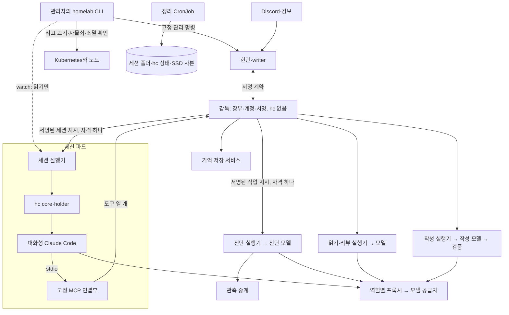

# 올리브의 감독, 실행기, hc

감독(O09), 오케스트레이터(O10), 세션 파드 안 hc 검증(O02)의 구현 기준이다. 이 문서는 조사 초안(저장소 밖)을 줄인 것이고, 관리자 결정은 `spec.md` §5.1이 기준이다. 초안과 §5.1이 다르면 §5.1이 이긴다. Discord 글의 모양은 `discord.md`, 진단 과정은 `diagnosis.md`를 따른다.

- 상태: 구현 전. D-37(작업자와 hc의 자리), D-38(켜고 끄는 값과 정지 자물쇠), D-39(정지 완료의 증거)는 관리자 결정이다. §11의 항목은 기본값(관리자 미확정)이다. 결정에서 따라 나온 구현 설계는 [추론]으로 구분한다.
- 표시: [확인] 저장소의 선언·코드, 공식 문서, hc 0.1.17과 Argo CD 3.5.5의 소스를 읽은 것. 조사 초안의 대조와 반박 검토가 확인했다고 적은 것만 붙였다. [추론] 그 근거에서 낸 설계. [미확인] 실제로 돌려 봐야 아는 것. 소스를 읽은 것은 돌려 본 것이 아니다.
- 근거: `homelab`의 `5f85a642b09364606b6990aa73af9927df23dbbd`. 저장소 경로는 이 revision 기준이다.
- 파드·네임스페이스 이름, 경로, 숫자, 명령 이름은 모두 초안이다. O09·O10이 정한다.

## 1. 한눈에 보기

- **감독**은 모델이 아닌 프로세스다. 장부, 계정 묶음, 지시 서명 키를 쥔다. hc도 Kubernetes 쓰기 권한도 없다.
- **실행기**는 파드마다 하나 있는 고정 프로그램이다. 감독이 서명한 지시만 받아 모델 프로세스를 띄우고 끝낸다. 명령·이미지·경로를 밖에서 받지 않는다.
- **hc는 오케스트레이터 세션 파드에만 있다**(D-37). 그 파드의 실행기가 감독의 지시로만 쥔다.
- **작업자**(진단, 읽기·리뷰, 작성)는 역할별 파드에서 실행기가 직접 띄운다. hc 터미널이 아니다. `spec.md` D-01의 "하위 에이전트"가 이것이다.
- **켜고 끄기와 비상 정지**는 관리자의 `homelab` CLI가 한다(D-21, D-38). 정지의 마지막 확인도 CLI가 한다(D-39).
- **보기**는 `homelab olive watch`다. 본체 화면과 작업자가 하는 일을 보기만 한다. 작업자에 끼어들 수 없고 취소만 된다.

### 1.1 파드와 네임스페이스 [추론, 이름은 초안]

| 네임스페이스 | 도는 것 | 쥐는 것 | 없는 것 | 비상 정지 때 |
|---|---|---|---|---|
| `app-homelab-bot` | 현관·writer | Discord·GitHub 쓰기 자격, 현관 DB | 모델 계정, hc, 감독 장부 | 떠 있음(접수만 닫힘) |
| `olive-control` | 감독 | 감독 장부, 계정 묶음, 지시 서명 키 | hc, 모델 프로세스, 클러스터 토큰, Kubernetes 쓰기 | 0개 |
| `olive-session` | 세션 실행기 → hc core·holder → 대화형 Claude Code, 고정 MCP 연결부, 관리 훅 | 이번 세션의 자격 하나, 세션 폴더(hc 상태 포함) | 다른 계정, 서명 키, 현관 DB | 0개 |
| `olive-diagnosis` | 진단 실행기 → 진단 모델·격리 셸 | 고정 snapshot, 자격 하나, 관측 중계 주소 | hc, 클러스터 토큰 | 0개 |
| `olive-reader` | 읽기·리뷰 실행기 → 도구 없는 모델(격리 읽기, PR 리뷰, 반박 검토) | 현관이 넘긴 자료, 자격 하나 | hc, fetch, 클러스터 | 0개 |
| `sandbox` | 작성 실행기(지금 `worker-task` 형태) → 작성 모델 → 검증 실행기 | 작업 PVC, 고정 snapshot | hc, 현관 자격, live cluster | 0개 |
| `olive-observation` | 관측 중계 | 진단 전용 읽기 SA | 모델, GitHub 쓰기 | 떠 있음 |
| `olive-memory` | 기억 저장 서비스(코드만) | 지도, 30일 메모, 승인 지식 snapshot | 서명 키, 모델 계정, hc | 떠 있음 |
| 원문을 둔 곳마다 | 정리 CronJob | 지울 권한만 | 모델, hc, 실행 시작권 | 돈다 |

- 구성 요소 다섯(`spec.md` §4)은 역할이고 파드 수와 다르다. `start_worker`는 미리 배포된 실행기에 새 모델 프로세스를 시작하게 할 뿐 파드를 만들지 않는다. 그래서 감독에게 Kubernetes 쓰기 토큰이 필요 없다.
- "0개"인 다섯(감독, 세션, 진단, 읽기·리뷰, 작성)이 이 문서의 **실행 Deployment**다. 모델 자격이 닿는 파드다.
- [확인] 옛 작성 실행기는 시작할 때 PID 1과 자신 말고 프로세스가 있으면 거절하고, 끝낼 때 파드의 PID 공간 전체에 TERM·KILL을 보낸다. Unix 소켓을 모두 허용하는 설정도 있다(옛 봇 `src/task-containment.ts`, `src/executor-claude-task.ts`). 작성 파드에 hc를 넣지 않는 이유다.
- [확인] 작성 파드의 보안 예외는 CI가 `sandbox`의 그 파드에만 허용한다(`tools/ci/policy.ts`). 공용 앱 차트는 같은 네임스페이스 전체 연결, DNS, 일반 인터넷 443을 열고 SA 토큰을 자동 마운트한다. [추론] 감독과 모델 파드는 전용 `platform/` 차트로 만든다. 프록시 허용 목록은 역할별로 나눈다.
- [확인] PID 상한은 파드 `resources.limits`가 아니라 kubelet 설정(`podPidsLimit`)이다.

## 2. hc의 자리와 쥐는 규칙

### 2.1 확인된 사실 [확인, hc 0.1.17 소스]

- client별 인증·권한이 없다. core 소켓에 닿으면 그 계정으로 명령 실행, 파일 읽기·쓰기, 터미널 입력·종료를 모두 할 수 있다. holder 소켓도 같다(argv·env·cwd를 받아 프로그램을 띄운다).
- `hc run`은 부른 쪽이 아니라 **core의 환경**을 프로그램에 넘긴다. CLI가 따로 넘기는 것은 TERM 계열 변수 넷뿐이다.
- API로 넘긴 env override는 `terminals.json`에 남는다. argv도 기록된다.
- core는 프로그램 환경에 터미널 소켓 경로(`HC_TERMINAL_SOCKET`) 등을 넣는다. "경로를 모를 것"은 방어가 아니다.
- holder가 core를 다시 띄울 수 있다. `hc kill`은 종료 기록과 마지막 화면을 남기고, `hc rm`은 삭제 오류를 무시한다.
- 종료 뒤 기본 보관은 24시간·500개다. 받은 시각 기준이 아니다.
- `hc attach --observe`는 키 입력과 크기 변경을 보내지 않는다. 그러나 화면의 제어 문자를 거르지 않고, core가 없으면 새로 띄운다. observe는 권한 등급이 아니다.
- machine 연결에는 원격에서 로컬 부모 터미널로 `send`가 가는 길이 있다.

### 2.2 규칙(D-37)

1. **자리:** hc는 세션 파드에만 있다. 감독 파드와 작업자 파드에는 hc 실행 파일도 소켓도 없다.
2. **쥐는 자:** 세션 실행기만 hc를 쥔다. 감독의 서명된 지시(§9.2)가 있을 때만 core를 띄우고 프로그램을 연다.
3. **세션마다 새 core:** 하루 교체(§6)와 계정 세대가 바뀔 때마다 core를 새로 띄우고, 그 core의 환경에 이번 자격 하나만 준다. 같은 core를 두고 자격만 바꾸지 않는다.
4. **자격을 argv와 env override로 넘기지 않는다.** hc 상태 파일에 남는다. 실행기 자신의 연결 키와 영수증 키는 core 환경에 넣지 않는다.
5. **정지의 증거로 쓰지 않는다:** `hc kill`, core 종료, hc의 종료 기록은 프로세스가 사라졌다는 증거가 아니다. 증거는 §7.4다.
6. **hc 상태는 원문이다:** hc의 상태·화면·로그 경로를 세션 폴더 안에 둔다. 받은 때부터 168시간이고 세션 폴더와 함께 지운다. 종료 뒤 기본 보관에 기대지 않는다.
7. **소켓 둘 다 가린다:** client 소켓과 holder 소켓을 모델 도구에서 모두 가린다. 방법은 O02·O10이 정하고 시험한다 [미확인].
8. **machine 등록 금지:** 관리자 개인 hc에 올리브 파드를 machine으로 등록하지 않는다. 올리브의 core를 다른 core에 잇지도 않는다.
9. **상태 표시는 보조다:** hc의 idle·done과 화면의 "완료", "승인됨"은 성공·승인의 증거가 아니다. 감독은 자기가 낸 실행 ID, 관리 훅 이벤트, 결과 저장 영수증을 대조한다.

### 2.3 보기: `homelab olive watch` [추론]

- 본체 화면은 세션 실행기의 고정 읽기 전용 내보내기에서 받는다. 작업자가 하는 일은 감독 장부의 실행 목록, 단계, 정제된 출력으로 본다. 작업자 화면은 hc에 없다.
- 관리자 쪽 CLI 코드가 제어 문자를 걸러 그린다. 원시 화면 바이트를 관리자 단말에 그대로 쓰지 않는다.
- 입력을 보내지 않는다. 키, 붙여넣기, 크기 변경, 단말 질의 응답이 세션에 가지 않는다.
- 있는 core만 본다. core가 없거나 정지 중이면 "볼 것 없음"으로 끝난다. `hc attach --observe`를 그대로 감싸지 않는다.

## 3. 작업자 한 번의 수명 [추론]

상태는 `queued → preparing → running → stopping → checking → ready_result → finalized`다. 실패는 `not_started`, `failed_stopped`, `unknown_running`, `cleanup_pending`으로 나눈다. 연결 끊김, 모델 종료 코드, 화면의 "완료"만으로 `ready_result`를 만들지 않는다.

1. **요청과 자리:** 오케스트레이터가 `start_worker`를 부른다. 감독이 입력 참조, 목적, 대상 저장소(D-25), 정지 세대, 예산, 중복 키를 본다. 작업자 슬롯은 하나다(B-07). 검증, 반박 검토, 자체 리뷰, 기억 초안도 같은 슬롯을 쓴다.
2. **계약 고정:** 감독이 실행 ID, 세대, 역할, 프로필·정책 revision, snapshot digest, 계정과 방식, 기한, 남은 예산을 장부에 적는다. 계정·모델·도구·이미지·경로는 서버의 역할 프로필에서 나온다. 요청문이나 결과의 글이 이 값을 바꾸지 못한다.
3. **자격 하나와 폴더:** 실행기가 지시를 검증한다(§9.2). 감독은 계정 묶음에서 이번 자격 하나만 넘긴다. 실행기는 그 값을 모델 프로세스의 환경에만 넣고 argv, 결과, 남는 파일에 쓰지 않는다. 도구 환경에서는 지운다. 방화벽, 격리, 자격 가림 가운데 하나라도 실패하면 모델을 띄우지 않는다.
4. **실행:** 감독의 실행 기록과 실행기의 접수 영수증을 먼저 남긴 뒤 띄운다. 전송이 시간 초과되면 새 실행을 만들지 않고 같은 실행의 상태를 묻는다. 계정 전환과 재시도가 예산을 새로 주지 않는다.
5. **끝내고 결과 검사:** 실행기는 먼저 남은 프로세스 0개를 확인한다. 그 뒤 결과의 모양, 크기, 출처 참조, digest를 보고 비밀 검사를 한다. 작성 결과는 digest를 고정한 뒤 네트워크 없는 검증과 자체 리뷰를 차례로 거친다. 같은 digest에 두 영수증이 다 있어야 게시 후보다.
6. **저장 확인과 정리:** 감독이 결과 저장을 마치고 확정을 보내면 실행기가 자격, tmp, 작업 폴더, 중계 접근을 지운다. 정리가 실패하면 `cleanup_pending`이고 다음 실행을 받지 않는다. 프로세스가 살아 있는지 모르면 `unknown_running`이고 슬롯을 놓지 않는다.

- 시작 허가(30초)는 실행 시간이 아니다. 실행기는 감독의 갱신을 주기로 받고, 끊기면 입력과 도구를 닫고 끝낸다(주기는 §11 S-10).
- [확인] 옛 작업자에는 "접수는 됐지만 결과가 없음"을 새 실행으로 바꾸지 않는 구조와 결과 확정이 있다(옛 봇 `src/task-worker.ts`). 여기서 출발한다.

## 4. 오케스트레이터의 도구 열 개 [추론]

MCP 서버 이름은 `olive`다. 도구는 아래 열 개뿐이다. 입력·반환의 세부 모양은 O09·O10이 계약 파일로 정한다.

공통: 외부 URL, 절대 경로, 셸, PodSpec, 모델명, 계정명, 승인 여부를 인자로 받지 않는다. 세션과 호출 주체는 인증된 연결에서 얻는다. 같은 호출 ID에는 같은 결과를 준다. 정지 중에는 모든 새 호출을 거절한다.

| 도구 | 한 줄 뜻 | 꼭 필요한 거절 |
|---|---|---|
| `request_reply` | 현관에 답 글을 부탁한다. 보낼 곳은 현관이 원래 입력에서 고른다 | 경보 자동 진단의 시작 글(👀만, D-31), 두 번째 시작 글, 감독이 확정한 등급 없는 진단 글, 공개 검사 실패 |
| `request_approval` | 보호 경로를 건드린 게시 후보에 확인 카드를 부탁한다. 카드 내용은 현관이 만든다 | 보호 경로가 아님, 자기 저장소(D-25), 후보가 바뀜, 만료 카드의 자동 재발급. 승인 도구는 없다 |
| `request_publication` | PR, PR 리뷰, 지식 PR의 게시를 부탁한다 | 자기 저장소, 검증·리뷰·반박 영수증 없음, 등급 부족(D-34), 승인 없음·만료, digest 불일치, 기준 충돌 |
| `read_observation` | 정해 둔 보기 다섯(서비스, 배포, 작업 진행, 경보, 게시 상태)을 읽는다 | 목록 밖 보기, 이 요청과 무관한 대상. 임의 kubectl·질의·URL은 없다 |
| `start_worker` | 역할과 목적을 정해 작업자를 부탁한다 | 허용되지 않은 역할·목적 조합, 자기 저장소, 고정되지 않은 원본, 외부 코드 실행, 근거 문이 닫힘(D-34), 앞 실행의 종료 미확인 |
| `worker_status` | 실행의 상태와 단계를 본다 | 자기 요청의 실행이 아님. 계정명·PID·화면은 주지 않는다 |
| `worker_result` | 검사를 거친 결과 요약과 참조를 받는다 | 결과가 검사 실패, 만료, 정리 대기. 모름을 빈 성공으로 바꾸지 않는다 |
| `cancel_worker` | 자기 요청의 실행을 취소한다 | 남의 실행. "취소 접수"는 완료가 아니다. 전체 비상 정지 도구는 없다 |
| `search_memory` | 승인된 지식, 지도, 장애 색인을 찾는다 | 후보 브랜치, 닫힌 PR, 원문 저장소. 30일 메모는 그 범위를 명시로 고를 때만 "검증 안 된 메모"로 준다. 삭제 원장을 못 읽으면 오류다 |
| `propose_memory` | 오래 남길 후보를 낸다. PR로 묶여 관리자가 병합한다 | 출처 없음·만료, 민감한 내용, 권한·정책을 바꾸는 글. 충돌은 보류다 |

- `read_observation`이 좁다고 진단 작업자의 읽기(D-20)가 좁아지는 것은 아니다.
- 등급(D-34)은 감독의 코드가 매긴다. 승인 낱말과 카드의 시간은 현관의 코드가 `spec.md` §11.2대로 본다.

## 5. 대화형 Claude Code의 관리 설정

### 5.1 확인된 사실과 함정 [확인, 공식 문서]

- `--tools ""`는 기본 도구를 끈다. MCP 도구에는 영향이 없고, MCP 도구가 남아 있으면 `EndConversation`이 남는다([CLI reference](https://code.claude.com/docs/en/cli-reference#cli-flags)). `--allowedTools`는 묻지 않고 실행하게 하는 목록이지 쓸 수 있는 도구를 좁히지 않는다.
- 관리 MCP 파일(`/etc/claude-code/managed-mcp.json`)이 있으면 사용자·프로젝트·플러그인의 MCP를 막는 배타적 통제가 된다. 예외: 다른 관리 서버, 앱이 넣는 내장 서버, 허용했을 때의 Claude in Chrome([Managed MCP](https://code.claude.com/docs/en/managed-mcp#exclusive-control-with-managed-mcp-json)).
- **`--mcp-config`와 `--strict-mcp-config`는 어느 하나라도 넣으면 안 된다.** 관리 MCP 파일이 있는 곳에서는 시작할 때 종료한다. 옛 작성 어댑터의 이 플래그를 복사하지 않는다.
- 관리 설정 파일(`/etc/claude-code/managed-settings.json`)의 키 여덟 개가 실재한다: `allowManagedPermissionRulesOnly`, `allowManagedHooksOnly`, `permissions.disableBypassPermissionsMode`(값은 문자열 `"disable"`), `autoMemoryEnabled`, `promptSuggestionEnabled`, `awaySummaryEnabled`, `idleCompaction`, `autoContinueAtUsageLimit`([Settings reference](https://code.claude.com/docs/en/settings-reference)).
- `allowManagedHooksOnly`를 켜도 내장 mod와 강제로 켠 플러그인의 훅은 돈다.
- 훅이 오류를 내거나 시간 초과되면 기본으로는 진행을 막지 않는다. `"onFailure": "block"`을 줘야 막고, v2.1.295 이상이 필요하다([Hooks](https://code.claude.com/docs/en/hooks#block-the-action-when-a-hook-fails)).
- `awaySummaryEnabled`는 환경변수 `CLAUDE_CODE_ENABLE_AWAY_SUMMARY`가 세션 하나에서 설정을 이긴다. 환경 허용 목록을 함께 고정해야 한다.
- 옛 작성 어댑터는 관리 설정 경로가 있으면 거절한다(옛 봇 `src/executor-claude-task.ts`). 오케스트레이터의 관리 설정을 작성 이미지에 넣으면 작업자가 닫힌다.

### 5.2 조립 기준 [추론]

- 세션 실행기는 전용 폴더에서 고정 argv `claude --tools ""`로 대화형 프로세스를 hc 터미널로 연다. `-p`, `--resume`, `--dangerously-skip-permissions`, `--mcp-config`, `--strict-mcp-config`는 하루 교체의 새 세션에 넣지 않는다.
- 관리 MCP 파일에는 `olive` 서버 하나만 둔다(stdio, 고정 실행 파일). 연결부는 모델 자격을 감독으로 가는 요청에 싣지 않는다.
- 관리 설정: 위 키 여덟 개에 더해 `permissions.allow`에 MCP 도구 열 개의 정확한 이름, `permissions.deny`에 기본 실행·파일·웹·하위 에이전트 도구를 적는다.
- `PreToolUse` 관리 훅은 정확한 도구 이름과 입력 모양만 통과시킨다(`onFailure: "block"`, 시간 제한). 통과한 호출도 감독이 세션, 세대, 대상, 정지 상태를 다시 본다.
- 작업 폴더에 `.mcp.json`, 임의 설정, 플러그인, 훅을 두지 않는다. 환경변수는 허용 목록으로만 준다. 역할마다 이미지를 나눈다.
- [미확인] 실제 대화형 세션에서 이 설정들의 조합, 처음 뜨는 trust 화면, 버전에 남는 도구, goal check-in을 끄는 환경변수의 효력. O10·O21이 고정 버전으로 확인한다.

## 6. 하루 한 번 세션 교체와 인계 [추론]

하루 한 번 새 세션과 세션별 폴더는 D-22다. 시각(매일 04:00 Asia/Seoul)과 현재 턴에 주는 최대 5분은 기본값(관리자 미확정, §11 S-06)이다. 교체를 위해 모델을 부르지 않는다.

1. 감독이 교체 예정을 장부에 적고 새 입력을 잠시 대기시킨다. 현재 턴에 최대 5분을 준다. 원문 만료, "잊어 줘", 비상 정지는 기다리지 않는다.
2. 감독이 장부의 구조화 상태로 인계 묶음을 만든다: 요청과 목적, 끝난 단계, 다음 단계, 진행 중 실행 ID, 결과·카드 참조, 남은 예산, 처리 위치. 자격, 옛 화면, 전체 대화는 넣지 않는다.
3. 감독이 옛 세션의 호출권을 거두고 세션 실행기에 종료를 지시한다. 실행기는 Claude, MCP 연결부, 훅, hc holder와 core를 끝내고 남은 프로세스 0개를 확인해 영수증을 낸다. 확인하지 못하면 새 세션을 열지 않는다.
4. 새 세션 폴더(새 UUID, 전용 HOME·설정·tmp·hc 상태)에서 **새 core**와 **새 대화**를 연다. 하루 교체는 `--resume`을 쓰지 않는다. 인계 묶음은 참고 자료다. 승인과 실행 권한은 감독·현관의 장부에서 다시 읽는다.
5. 처리 위치 뒤의 대기 입력을 한 번씩 전한다. 옛 세션 폴더와 그 SSD 사본은 정리 작업이 폴더째 지운다(O18).

- 작업자는 교체 중에도 감독의 같은 실행으로 계속된다. 새 세션이 같은 목적의 `start_worker`를 다시 불러도 기존 실행을 돌려준다.
- 계정 전환 때의 이어 열기는 다른 계약이다(O03, O17). 그때도 core는 새로 띄운다.
- 인계는 보관 시계를 새로 시작하지 않는다. 요약은 처음 출처의 만료를 이어받는다.

## 7. 비상 정지(D-21, D-38, D-39)

걸기도 풀기도 `homelab` CLI에서만 한다. Discord의 "멈춰"는 이 기능을 부르지 않는다. 감독도 정지 때 내려가므로, 순서를 이끌고 마지막을 확인하는 것은 CLI다.

### 7.1 켜고 끄는 값(D-38)

1. Git에는 실행 Deployment를 `replicas: 0`으로 둔다. 그 칸만 Argo CD 예외로 둔다(정확한 리소스의 `/spec/replicas`에 `ignoreDifferences`와 `RespectIgnoreDifferences=true`). 켜고 끄기는 `homelab` CLI가 한다.
2. 정지할 때 CLI가 실행 네임스페이스마다 "파드 0개" 한도(ResourceQuota, Git 밖)를 먼저 건다. 이 문서의 **자물쇠**다. 풀 때 지운다.
3. Git 허가 스위치는 정지 설계에 넣지 않는다. 올리브를 걷어낼 때는 CLI로 정지한 뒤 PR을 올린다.
4. 알림은 어긋날 때만 온다(§7.5).
5. 정지 명령은 진행 중인 동기화를 기다려 0을 다시 확인하고, 접수·차단·실제 소멸을 따로 보고한다(§7.3).

### 7.2 Argo CD와의 관계

- [확인] 예외 없이 `kubectl scale`만 하면 selfHeal이 약 5초 만에 되돌린다(`platform/root/templates/_helpers.tpl`).
- [확인] 같은 장치가 이미 운영 선언에 있다. `platform/root/templates/cnpg-cluster.yaml`이 annotation 두 칸에 쓴다. replicas에 쓰는 것은 처음이다.
- [확인] 이 예외는 "CLI만 그 칸을 쓴다"가 아니다. **Argo CD는 읽은 라이브 값을 다시 쓴다**(3.5.5 소스). [추론] 정지 전에 1을 읽은 동기화가 정지 뒤에 1을 쓸 수 있다(재현은 안 했다 [미확인]). 자물쇠를 먼저 거는 이유다. replicas가 1로 돌아와도 파드가 생기지 못한다.
- [확인] 라이브 리소스가 없으면 Git 값으로 만든다. 그래서 Git 값은 0이고, 빈 클러스터에서 다시 만들면 꺼진 채 시작한다.
- [확인] 수동 sync는 요청에서 옵션을 바꿀 수 있고, SSA의 field manager도 잠금이 아니다. 예외를 끈 수동 sync까지 막아 주지 않는다.
- [확인] root에서 구성 요소를 끄면 Application만 지워지고, finalizer가 없어 Deployment가 남는다. "Git에서 끄면 꺼진다"를 정지로 쓰지 않는다.
- [확인] 자식 Application의 health가 root에 전파된다(`platform/argocd/argocd-cm.yaml`). replicas 0이어도 Pending PVC나 실패한 ExternalSecret으로 root가 멈출 수 있다.
- [확인] ResourceQuota와 admission 정책은 이 저장소에 아직 없다. 지금 CI는 작성 Deployment의 replicas 0과 1을 모두 받고, `platform/sandbox/values.yaml`의 켜고 끄는 절차는 Git 값 기준이다. [추론] 둘 다 D-38에 맞게 고친다(보호 경로, B-12).
- 자물쇠의 한계 [추론]: 한도는 새 파드의 생성만 막는다. 이미 뜬 파드는 막지 못한다. 그래서 replicas 0과 소멸 확인이 함께 있어야 한다.
- 정지 중에도 떠 있어야 하는 것(현관, 관측 중계, 정리 작업, 프록시)은 실행 네임스페이스 밖에 두거나 한도에서 뺀다(기본값, §11). 세션 폴더의 정리 작업을 빼는 방법은 O09·O18이 정하고 시험한다 [미확인].

### 7.3 걸 때의 순서 [추론]

| 순서 | 누가 무엇을 | 실패하면 |
|---|---|---|
| 1. 접수 | CLI가 현관에 새 정지 세대를 낸다. 현관이 새 입력 전달, 게시, 승인을 닫는다 | 현관에 닿지 못해도 2부터 계속하고 닿지 못한 곳을 적는다 |
| 2. 자물쇠 | CLI가 실행 네임스페이스마다 "파드 0개" 한도를 건다 | 걸지 못한 곳을 보고한다. 차단 미완이다 |
| 3. 권한 폐기 | 현관이 쓰지 않은 카드·승인·게시 허가를 무효로 한다(D-26). 감독이 세션 호출권, 실행 갱신, 새 자격 발급을 끊는다 | 이것으로 소멸을 주장하지 않는다 |
| 4. 실행 종료 | 감독이 실행기들에 종료를 지시한다. 실행기는 TERM → 시한 → KILL → 자식 확인 | 감독이 죽어 있으면 건너뛴다. 5가 파드를 내린다 |
| 5. replicas 0 | CLI가 정해진 실행 Deployment만 0으로 내린다. 강제 삭제는 쓰지 않는다 | 내리지 못한 대상을 보고한다 |
| 6. 다시 확인 | CLI가 진행 중인 Argo CD 동기화가 끝나기를 기다려 0을 다시 본다 | 1로 돌아와 있으면 다시 내린다 |
| 7. 소멸 확인 | §7.4의 단계대로 | 확인하지 못한 단계를 그대로 보고한다 |
| 8. 보고 | CLI가 접수, 차단, 실제 소멸을 따로 말한다 | 접수만 된 것을 "정지 완료"라고 하지 않는다 |

- 대상은 CLI의 고정 목록이다. Git의 실행 Deployment 목록, 예외 목록과 같아야 한다(CI 검사, §11).
- 정지 전에 이미 나간 GitHub 요청은 뒤늦게 성공할 수 있다. 현관은 그 건을 조회만 한다.
- NUC에서 직접 정지를 거는 길을 준비한다(기본값, §11). 어디에도 닿지 못하면 정지를 보장할 수 없다고 보고한다.

### 7.4 정지 완료의 증거(D-39)

| 단계 | 어디서 | 보는 것 | 결과의 이름 |
|---|---|---|---|
| 기본 | 어디서 실행하든 | Kubernetes에서 실행 파드 0개, 강제 삭제가 아님, 자물쇠가 걸림 | 정지됨(노드 미확인) |
| 노드 | NUC에서 실행하면, sudo 없이 | 위에 더해 그 파드들의 cgroup이 비었는지 | 정지 완료(노드 확인) |
| `--deep` | NUC에서, sudo로 | 위에 더해 컨테이너 런타임의 목록 대조 | 정지 완료(노드 확인, 런타임 대조) |

- 어느 결과든 새 일은 받지 않고 자물쇠는 걸려 있다. 풀기는 실행 파드 0개만 확인되면 된다.
- [확인] 이 NUC에서 파드 cgroup의 `cgroup.events`는 누구나 읽을 수 있고(0444), containerd 소켓은 root 전용(0660)이다. `populated=0`은 그 하위 트리에 살아 있는 프로세스가 없다는 뜻이다.
- [확인] 강제 삭제는 kubelet의 확인을 기다리지 않는다. 강제 삭제였다면 API에서 파드가 사라진 것이 종료의 증거가 아니다. 그래서 기본 단계는 강제 삭제가 아님을 함께 본다.
- [추론] CLI는 내리기 전에 파드 UID를 적어 두고, 그 UID의 cgroup이 비었거나 사라졌는지 본다.
- [미확인] hc의 holder와 그 자식이 파드 cgroup 안에 있는지. O02가 확인한다.

### 7.5 알림(D-38)

- 켜 둔다고 했는데 실행 파드가 15분째 꺼져 있으면 알린다.
- 정지했는데 실행 파드가 떠 있으면 바로 알린다.
- 일부러 건 정지는 시작과 끝에 한 번씩만 알린다. 이어지는 동안 반복해 알리지 않는다.
- 올리브 자신의 일이라 Telegram으로만 간다(D-28).
- [추론] 감독이 내려가 있어도 알림이 나와야 하므로 판단은 경보 규칙이 한다. "켜 둠/정지"를 무엇으로 알지는 O09가 정한다. 후보는 자물쇠의 유무다. 처음 배포한 직후처럼 한 번도 켠 적이 없는 상태는 "켜 둠"이 아니므로 "15분째 꺼짐"이 울리면 안 된다.

### 7.6 정지 유지와 풀기 [추론]

- 정지는 감독·현관의 재시작, 노드 재부팅, hc 복구, 한도 리셋, Argo CD 동기화로 풀리지 않는다. 자물쇠는 클러스터에, 정지 기록은 현관에 남는다. 두 번째 SSD에 정지 원장을 따로 둘지는 O09가 정한다.
- 풀기(`homelab olive stop off`): 실행 파드 0개, 정책 revision, 확정되지 않은 외부 효과를 확인한다 → 자물쇠를 지운다 → 감독과 실행기를 접수가 닫힌 채 올려 기동 검사를 한다 → 새 실행 세대를 적는다 → 현관의 접수를 마지막에 연다.
- 옛 확인 카드, 옛 세션, 옛 실행은 되살리지 않는다. 계정 API 잠금과 자동 진단 일시 중지는 풀리지 않는다. 도중에 실패하면 다시 정지 상태로 두고 올라온 파드를 내린다.

## 8. 감독 장부와 재시작 복원 [추론]

장부는 전용 SQLite이고 감독 하나만 쓴다(기본값, §11 S-04). DB 오류나 디스크 부족이면 새 실행은 0건이다. 장부에 원문과 자격 값을 넣지 않는다. 감독은 현관 DB에 접근하지 않는다.

| 저장하는 것 | 요지 |
|---|---|
| 입력·대기열 | 요청 ID, 인증된 출처, 원문 참조와 만료, 순서, 처리 위치, 취소 |
| 실행·슬롯·예산 | 실행 ID, 세대, 프로필 revision, snapshot digest, 실행기 ID, 시작·종료 영수증, 남은 예산 |
| 장애 색인 | 경보, 시각, 실행, PR, 결과 enum, 재진단 횟수와 다음 허용 시각(D-27, D-28) |
| 계정 장부 | 계정 별칭, 방식, 한도 리셋 시각, 계정별 다음 크레딧 지급 예정일, API 잠금 사유, 수동 선택(O17) |
| 정지·일시 중지 | 정지 세대, 확인 단계, 자동 진단 일시 중지의 만료 |
| 세션·인계 | 세션 ID, 폴더 목록, 교체 시각, 처리 위치, 인계 참조 |
| 게시 연결 | 후보 digest, 현관 작업 ID, 대기·확정·모름. 승인과 게시의 최종 상태는 현관이 가진다 |
| 병합 뒤 확인 | PR, 병합 SHA, 고정된 확인 내용, 기한, 영수증. 한 번만 |
| 삭제 진행 | 대상 참조, 만료, 삭제 세대, 본체·사본·세션 처리 확인 |

재시작은 아래 순서로만 연다.

1. 모든 입력과 실행 접수를 닫고 단일 작성자 잠금을 잡는다. 더 새로운 정지·삭제 세대를 먼저 적용한다.
2. 현관, 관측 중계, 실행기의 계약 버전을 맞추고 장부의 실행과 실행기의 실제 점유를 대조한다. 장부에 없는 실행은 종료 대상이다.
3. 진행 중이던 실행은 상태와 결과를 묻는다. 시작 영수증만 있고 결과가 없으면 스스로 다시 실행하지 않는다. 증명하지 못하면 슬롯을 막은 채 `unknown_running`이다.
4. 확정되지 않은 게시는 현관에 작업 ID로 묻는다. 시간 초과를 "게시 안 됨"으로 바꾸지 않는다.
5. 계정 잠금, 예산, 진단 횟수, 일시 중지, 병합 뒤 확인을 복원한다. 정지 상태가 아니고 모두 맞으면 새 세션을 열고 현관의 접수를 연다.

## 9. 계약

### 9.1 감독과 현관 [추론]

- 이름은 `olive-control/v1`이다. 서로 TLS로 상대를 확인하고, 바깥에 효과를 내는 요청에는 Ed25519 서명을 더한다(기본값, §11 S-05). 현관, 감독, 실행기마다 키가 다르다. 모델과 hc에는 서명 키를 주지 않는다.
- 서명에 묶는 것: 낸 쪽, 받는 쪽, 동작, 요청 ID, 정지 세대, 실행 세대, 본문 digest, 만료 시각, nonce. 오래된 세대는 서명이 맞아도 거절한다.
- [확인] 옛 봇의 서명 봉투(받는 쪽·동작·digest·발급과 만료 대조, nonce 저장)에서 출발한다(옛 봇 `src/worker.ts`, `src/task-contracts.ts`). [추론] 감독이 현관에 내는 게시 요청은 현관이 다시 검사할 후보이고 실행 허가가 아니다.

| 방향 | 엔드포인트의 요지 |
|---|---|
| 서로 | 계약 버전과 정책 revision 확인. 맞지 않으면 새 효과를 막는다 |
| 현관 → 감독 | 요청 접수(인증된 출처, 원문 참조·만료), 요청 취소, 이벤트(승인 변화, 게시 변화, 병합 관측, 잊기), 정지와 풀기의 준비·확정 |
| 감독 → 현관 | 답 글, 확인 카드, 게시, 진행 상태(단계와 순번. 임의 문구 없음) |
| 서로 | 작업 ID로 결과 조회. 모름을 "없음"으로 바꾸지 않는다 |

- 시간 초과는 효과가 없었다는 증거가 아니므로 조회한다.
- 관리자 CLI는 지금처럼 관리자의 Kubernetes 인증으로 현관의 고정 관리 진입점을 부른다. [확인] 옛 구현의 계약 이름은 `homelab-bot-admin/v1`이다(옛 봇 `src/admin.ts`).

### 9.2 감독과 실행기 [추론]

- 지시의 종류: 세션 시작·종료, 작업 시작·취소, 실행 갱신, 결과 확정. 이것뿐이다.
- 실행기는 지시마다 서명, 받는 쪽, 본문 digest, 시한(30초), nonce, 세대, 자기 인스턴스·저장소 ID를 대조한다. 하나라도 틀리면 모델 실행 0건이다.
- 실행기는 명령, 이미지, 볼륨, argv, 환경을 지시에서 받지 않는다. 역할 프로필에 고정돼 있다.
- 자격은 지시와 같은 암호화 연결로 하나만 온다. 세션 실행기는 그 값을 새 core의 환경에만 넣는다(§2.2).
- 실행기는 접수, 시작, 종료 확인(남은 프로세스 0개), 정리의 영수증을 낸다. 감독은 영수증을 장부와 대조한다.
- 세션 파드의 MCP 연결부는 모델용 좁은 API만 부른다. 그 호출권으로 이 절의 지시를 낼 수 없다.

## 10. `homelab olive` 명령 [추론, 초안]

기본 출력은 짧은 한 줄이고 자세한 것은 `--verbose`에 둔다. 자격 값과 원문은 내지 않는다. 아래는 설계이고 지금 있는 명령이 아니다.

| 명령 | 하는 일 |
|---|---|
| `status` | 살아 있음, 대기, 작업, 자동 진단, 정지 상태 한 줄 |
| `queue`, `runs`, `run show <별칭>` | 대기열과 실행 보기 |
| `run cancel <별칭>` | 실행 취소. 종료 확인을 따로 보고 |
| `watch` | 본체 화면과 작업자 진행 보기. 입력 없음(§2.3) |
| `session status`, `session rotate` | 세션 상태, 지금 교체 |
| `start` | 실행 Deployment를 켠다(정지 중이면 거절) |
| `stop on`, `stop status`, `stop off` | 비상 정지 걸기(§7.3), 상태, 풀기(§7.6) |
| `stop verify [--deep]` | 소멸 확인. NUC에서 실행하면 cgroup까지, `--deep`은 sudo로 런타임 대조(§7.4) |
| `diagnosis pause --for <시간>`, `diagnosis resume` | 자동 진단 잠시 끄기(D-28) |
| `incidents`, `post-merge list`, `recovery status` | 장애 색인, 병합 뒤 확인, 재시작 복원 점검 |
| `memory status`, `memory forget <참조>` | 보관 상태, 잊기(O18) |
| 계정 명령 | `accounts.md` §7(O17) |

종료 코드는 §11의 기본값을 따른다 [확인: 옛 CLI에서 3은 거부, 4는 미지원이다]. 정지가 접수만 된 상태에서 0과 "정지 완료"를 내지 않는다.

## 11. 기본값(관리자 미확정)

관리자가 고르지 않은 것이다. `spec.md` §5.2 B-16이 이 목록을 가리킨다. 숫자는 재 본 값이 아니다.

| 항목 | 기본값 | 이유 |
|---|---|---|
| S-04 감독 장부 | 전용 SQLite, 감독 하나만 쓴다 | NUC 한 대와 감독 하나에 맞고 기대는 서비스가 준다 |
| S-05 내부 인증 | mTLS와 효과별 Ed25519 서명 | 제어와 자격 전달의 상대를 한 방식으로 묶는다 |
| S-06 세션 교체 | 매일 04:00 Asia/Seoul, 현재 턴에 최대 5분 | 시각이 일정하고 08:50 글과 겹치지 않는다 |
| S-09 자원 | B-07 전체(CPU 4개·메모리 8GB) 안에서 작성 중심으로 나눈다. 출발점: 감독 0.5 CPU·0.75GB, 세션 1 CPU·2GB, 도는 작업 2 CPU·4GB, 나머지 합쳐 0.5 CPU·1.25GB | 가장 무거운 것이 작성과 검증이다 |
| S-10 실행 감시 | 갱신 10초, 끊김 판정 30초, 준비 60초, 종료 유예 5초, 관리자 요청 우선(경보가 굶지 않게) | 실패를 빨리 닫는다. 느린 NUC에서 재야 한다 |
| S-08의 방향 | 현관의 Discord 입력 원문을 DB 밖으로 옮긴다. 확정은 O18이 안을 낸 뒤 관리자가 한다(`spec.md` §5.3) | [확인] R2의 PostgreSQL 백업 보존은 14일이다(`platform/cnpg/cluster/templates/objectstore.yaml`). 원문이 DB를 거치면 WAL과 함께 168시간을 넘겨 남는다 |
| CLI 종료 코드 | 옛 `homelab bot`의 뜻(3 거부, 4 미지원)을 바꾸지 않고 새 상태에는 새 숫자 | 같은 숫자에 다른 뜻을 주면 지금의 습관·스크립트와 엇갈린다 |
| D-38에 딸린 제약 | 정지 중에도 떠 있어야 하는 것은 실행 네임스페이스 밖에 두거나 한도에서 뺀다. CI에 "실행 Deployment의 Git replicas는 0"과 실행 대상·예외 대상·CLI 대상 목록의 일치 검사를 넣는다. NUC에서 직접 정지를 거는 길을 준비하고 시험한다 | 자물쇠가 정리 작업과 현관을 막지 않게, Git의 실수가 켜짐 쪽으로 가지 않게, 원격 접근을 잃어도 멈출 수 있게 |

시험 클러스터에서 한도가 기대대로 막지 않으면 관리자에게 다시 묻는다. 차선은 admission 정책이다(D-38).

## 12. 실제로 돌려 봐야 아는 것

아래는 [미확인]이다. 소스와 문서를 읽은 것만으로 통과로 치지 않는다. 가짜 표식과 고정 프로그램으로 한 번에 하나씩 한다. 통과하기 전에는 그 부분을 운영에 올리지 않는다.

| 티켓 | 돌려 볼 것 |
|---|---|
| O02 | 포함 관계: core·holder·프로그램·분리된 후손이 파드 cgroup 안인지. holder가 core를 다시 띄운 뒤, core 종료·holder 실패·`--outlive-parent`·파드 종료 뒤에도 노드에 후손이 없는지 |
| O02 | 가림: 모델·도구 쪽에서 client 소켓, 모든 holder 소켓, hc 상태·설정 경로, `/proc`·fd·symlink 별칭에 닿는지 |
| O02 | 자격: 실행 A·B에 다른 가짜 표식을 넣고 "새 core"와 "기존 core"에서 프로그램이 무엇을 받는지. env override가 상태 파일에 남는지. 종료·삭제 뒤 상태·로그·화면이 남는 자리 |
| O02 | 보기: watch의 무입력(키, 붙여넣기, 크기, 단말 질의), 제어 문자의 무해한 표본이 관리자 단말에서 실행되지 않는지, core가 없을 때 띄우지 않는지 |
| O09 | 경합: 라이브 1을 읽은 동기화의 쓰기를 늦추고 정지 뒤에 풀어 파드가 생기는지(이미지 변경, selfHeal, 수동 sync). 한도가 막는지, 떠 있어야 하는 것과 root의 뒤 wave를 막지 않는지 |
| O09 | 보존: 라이브 0·1에서 다른 칸은 적용되고 replicas는 유지되는지. Deployment 삭제·새 이름, Application 삭제, 예외 삭제의 결과 |
| O09 | 정지: 감독·GitHub·CI 없이 CLI만으로 되는지, TERM 무시와 느린 종료, NUC에서 직접 거는 길. 알림(반복 없음, 15분 꺼짐, 정지 중 뜸). 동시에 온 켜기·정지 |
| O09 | 장부: 시작 직전·직후의 전원 장애, 게시 시간 초과 뒤 중복. CPU·메모리·PID 상한 |
| O10 | 도구: 고정 버전의 실제 도구 목록, 관리 MCP의 배타성, 훅 오류·시간 초과, trust 화면, 환경변수 우회 |
| O10 | 세션: 입력 없는 1시간·하루 교체·한도 리셋에서 모델 호출 0번. 교체·계정 전환 뒤 앞 자격이 없는지, 작업자가 이어지고 중복 실행이 없는지 |
| O18 | 보관: 받은 지 167시간인 가짜 원문이 1시간 뒤 사라지는지. 살아 있는 holder, 열린 watch, core 재기동, SSD 복원 뒤에도 다시 보이지 않는지 |
| O21 | 운영에서 정지 → 확인 → 풀기 한 바퀴, 정지 중 동기화, `watch`. 재부팅과 앱 DB만 과거로 복원한 뒤에도 실행 파드 0개 |

클러스터 상태를 백업에서 되살리는 런북은 지금 없다 [확인]. 실행 중이던 replicas 1이 든 백업을 되살리는 경우는 그런 런북이 생길 때 다룬다.
